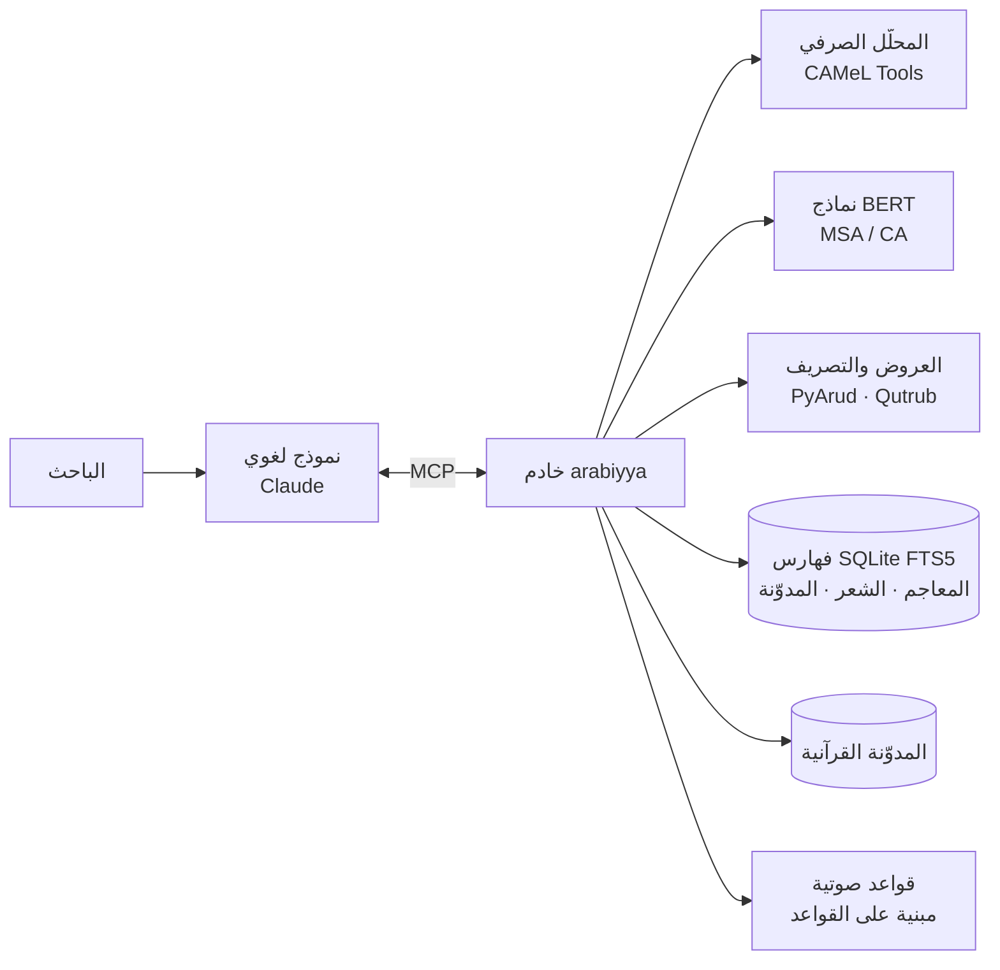

<div dir="rtl">

# العربية (arabiyya-mcp)

**بيئة حاسوبية لعلوم العربية تتصل بالنماذج اللغوية عبر بروتوكول MCP**

[English summary](#english-summary)

## الملخّص

يجمع هذا المشروع في خادم واحد، يعمل وفق بروتوكول سياق النموذج (Model Context Protocol)، أدواتٍ حاسوبية تغطي أبرز فروع الدرس اللغوي العربي، وهي:

- الصرف والتصريف.
- الضبط والعروض.
- الأصوات.
- المعجم التراثي.
- الصرف القرآني.
- الشواهد الشعرية.
- الدلالة التوزيعية.
- لسانيات المدوّنة والأسلوبية الإحصائية.

**الغرض:** أن يستند النموذج اللغوي في جوابه إلى مصادر ومحلّلات يمكن التحقق منها، لا إلى ما يستظهره. فكل نتيجة تُعزى إلى مصدرها بالجزء والصفحة، أو إلى الأداة التي أنتجتها. ويصحب كل أداة بيانُ حدودها المنهجية.

**طريقة العمل:** يعمل الخادم على جهاز الباحث. تُنزَّل البيانات مرة واحدة، ثم تعمل الأدوات بلا اتصال بالشبكة، عدا أداة `lexicon_lookup` وأداة `corpus_add_book` عند تنزيل كتاب جديد.

## المحتويات

1. [البنية](#البنية)
2. [الموارد اللغوية](#الموارد-اللغوية)
3. [الأدوات ومناهجها](#الأدوات-ومناهجها)
4. [حدود المنهج](#حدود-المنهج)
5. [التثبيت](#التثبيت)
6. [قابلية إعادة الإنتاج](#قابلية-إعادة-الإنتاج)
7. [المراجع](#المراجع)

## البنية



البيانات كلها في قواعد SQLite محلية، وفيها فهرسة نصية كاملة (FTS5) على نصوص موحّدة الرسم:

- تُحذف الحركات.
- تُردّ الهمزات (أ إ آ ٱ) إلى الألف.
- تُكتب التاء المربوطة هاءً، والألف المقصورة ياءً.

## الموارد اللغوية

| المورد | المحتوى | الاستعمال |
|---|---|---|
| CALIMA-Star (calima-msa-r13) | قاعدة صرفية للفصحى المعاصرة فيها السوابق والجذوع واللواحق وسماتها | التحليل والتوليد الصرفي |
| CAMeLBERT-MSA (BERT unfactored) | نموذج إزالة الالتباس الصرفي بالسياق | الترجيح السياقي والتشكيل |
| CAMeLBERT-CA | نموذج BERT مدرَّب على العربية الكلاسيكية | الدلالة التوزيعية |
| المدوّنة القرآنية (Quranic Arabic Corpus) | تحليل صرفي ونحوي لكلمات القرآن مقسّمة إلى أجزاء | الصرف القرآني ومواضع الجذور |
| مدوّنة «أشعار» (Ashaar) | 254,630 قصيدة و3,863,406 أبيات، بالشاعر والبحر والعصر والغرض | الشواهد والتحليل الأسلوبي |
| OpenITI: المعاجم | 15 معجمًا من العين (ت 170هـ) إلى تاج العروس (ت 1205هـ) | مادة الجذر بالجزء والصفحة |
| OpenITI: المدوّنة | 57 مصنَّفًا في النحو واللغة والبلاغة والشعر والأدب، من القرن الثاني إلى الحادي عشر، نحو 11.9 مليون كلمة | لسانيات المدوّنة |
| فهرس OpenITI | 8,792 نسخة أصلية (primary version) من نصوص عربية، بعناوينها ومؤلفيها | توسيع المدوّنة |

**المعاجم الخمسة عشر:** العين، وجمهرة اللغة، وتهذيب اللغة، والصحاح، ومقاييس اللغة، ومجمل اللغة، والمحكم، والمفردات، وأساس البلاغة، والنهاية، ومختار الصحاح، ولسان العرب، والمصباح المنير، والقاموس المحيط، وتاج العروس.

**تقطيع المعاجم إلى مواد:** يجري بحسب طريقة كل معجم في الترتيب:

- **معاجم التقاليب** (العين والجمهرة والتهذيب والمحكم): تُفهرس المادة بمفتاح لا يتغير بترتيب الحروف، فتُستخرج من باب تقاليبها.
- **لسان العرب:** بعناوين مواده.
- **القاموس المحيط:** في حدود الباب والفصل.

ويُردّ كل موضع إلى الجزء والصفحة بحسب علامات الصفحات في نصوص OpenITI.

## الأدوات ومناهجها

### ١. الصرف

| الأداة | المنهج |
|---|---|
| `analyze_word` | التحليلات الممكنة كلها للكلمة المفردة من قاعدة CALIMA-Star، بلا ترجيح: الجذر والوزن والمدخل والجذع وقسم الكلم والسمات الصرفية |
| `analyze_text` | تحليل الجملة مع اختيار التحليل الأرجح بالسياق عبر مُزيل الالتباس المبني على BERT (Inoue et al., 2022) |
| `root_family` | المداخل المعجمية كلها في القاعدة الراجعة إلى جذر واحد، بأوزانها وأقسامها ومعانيها |
| `conjugate` | تصريف الفعل في الماضي والمضارع بأحواله الثلاثة والمؤكد والأمر، معلومًا ومجهولًا، عبر قطرب (Zerrouki). وتُستخرج حركة عين المضارع من صيغة المضارع في القاعدة الصرفية، ويُختار الفعل غير المشكول من مرشحات المعجم الصرفي بحسب مطابقة الرسم |

**حساب الوزن الصرفي:** صيغة CALIMA تشمل السوابق واللواحق، وتُبقي حرف العلة المنقلب ظاهرًا كما هو. فيُجرَّد الوزن أولًا من:

- أدوات الجر والعطف والتعريف.
- الضمائر المتصلة.
- علامة الإعراب.

ثم يُردّ المعتل والمضعّف إلى الميزان الصرفي المعروف:

| الكلمة | وزنها في القاعدة | الوزن بعد الردّ |
|---|---|---|
| قال | فال | فَعَل |
| يقول | يَفُول | يَفْعُل |
| بيت | فَيْل | فَعْل |
| رمى | فَعَى | فَعَل |
| اختار | افتال | افْتَعَل |
| قائل | فائل | فاعِل |
| مُدّة | فُعَّة | فُعْلَة |

### ٢. الضبط والعروض

| الأداة | المنهج |
|---|---|
| `diacritize` | التشكيل بالتحليل الأرجح سياقيًّا لكل كلمة |
| `scan_verse` | التقطيع العروضي عبر PyArud: البحر، والتفعيلات، والزحافات والعلل، والقافية والروي |
| `scan_poem` | تقطيع القصيدة بيتًا بيتًا، وتحديد البحر والروي الغالبين، والتنبيه على كل بيت خالفهما أو اختل وزنه |

**أثر التشكيل في التقطيع:** التقطيع العروضي يتوقف على التشكيل التام، والتشكيل الناقص يُفسده. فيُقاس أولًا ما في البيت من تشكيل، أي نسبة الحركات إلى الحروف:

| نسبة التشكيل | المعالجة |
|---|---|
| أقل من 0.3 | يُشكَّل البيت آليًّا كله |
| من 0.3 إلى أقل من 0.85 | يُملأ الناقص من التشكيل الآلي، مع إبقاء ضبط الأصل حيث وُجد، كلمةً كلمة إذا تطابق رسم الكلمة في النصّين |
| 0.85 فأكثر | يُقطَّع البيت كما هو |

### ٣. الأصوات

**`phonetics`: تحويل الحروف إلى أصوات بالقواعد.** يحوّل النص المشكول إلى كتابة صوتية وظيفية (phonemic) بالأبجدية الصوتية الدولية (IPA)، مع مراعاة:

- همزة الوصل: تُنطق في الابتداء وتسقط في الدرج.
- اللام الشمسية والقمرية.
- التنوين.
- التقاء الساكنين: يُقصَّر المدّ ويُحرَّك الساكن.
- الوقف: بالسكون، وعلى تنوين النصب ألفًا، وعلى التاء المربوطة هاءً.
- الألف الفارقة.
- الألف المحذوفة رسمًا: هذا، ذلك، لكن، الله، إله، الرحمن، السماوات.

**التقطيع إلى مقاطع:** يبدأ كل مقطع بصامت واحد، وأنواع المقاطع خمسة:

| النوع | الوصف |
|---|---|
| CV | قصير |
| CVV | طويل مفتوح |
| CVC | طويل مغلق |
| CVVC | مديد |
| CVCC | مديد |

وتُقابَل المقاطع برموزها العروضية: `/` للمتحرك و`0` للساكن.

**النبر:** يُعطى تقريبيًّا بقاعدة الفصحى المعاصرة (Ryding, 2005):

- يقع على المقطع الأخير إن كان مديدًا.
- وإلا فعلى ما قبل الأخير إن كان طويلًا.
- وإلا فعلى الثالث من الآخر.

**`huruf`: المخارج والصفات.**

- **المخارج:** السبعة عشر على مذهب ابن الجزري في المقدمة الجزرية.
- **الصفات التي لها ضد:** الجهر والهمس، والشدة والتوسط والرخاوة، والاستعلاء والاستفال، والإطباق والانفتاح، والإذلاق والإصمات.
- **الصفات التي لا ضد لها:** الصفير، والقلقلة، والانحراف، والتكرير، والتفشي، والاستطالة، والغنة، واللين.
- **الوصف الصوتي الحديث:** موضع النطق، وطريقته، والرمز الدولي.
- **الموازنة بين حرفين:** تُصنَّف العلاقة بينهما بمصطلح أهل الأداء:
  - متجانسان: اتحدا مخرجًا.
  - متقاربان مخرجًا: تجاور مخرجاهما.
  - متقاربان صفةً.
  - متباعدان.
- **الخلاف بين الوصفين القديم والحديث:** يُنبَّه عليه، كجهر الطاء والقاف عند سيبويه، وجانبية الضاد القديمة.

### ٤. المعجم والقرآن والشعر

| الأداة | المنهج |
|---|---|
| `maajim` | مادة الجذر من المعاجم الخمسة عشر، مرتبةً بوفيات مؤلفيها، بالجزء والصفحة. وفي معاجم التقاليب يبدأ النص من موضع المادة داخل بابها |
| `lexicon_lookup` | البحث في نحو 47 معجمًا عربيًّا وعربيًّا إنجليزيًّا في موقع The Arabic Lexicon (يلزمه اتصال) |
| `quran_word` | أجزاء كل كلمة في الآية: النوع، والجذر، والصيغة، والسمات، والإعراب (Dukes & Habash, 2010) |
| `quran_root` | مواضع الجذر في القرآن، وصيغه وعدد كلٍّ منها |
| `search_poetry` | البحث النصي في مدوّنة «أشعار» بتوحيد الرسم، مع التقييد بالشاعر أو البحر أو العصر |

### ٥. الدلالة التوزيعية

تعتمد على نموذج CAMeLBERT-CA (Inoue et al., 2021). وتمثيل الكلمة هو متوسط الطبقات الأربع الأخيرة من النموذج، على الأجزاء التي يقطّعها إليها، مُطبَّعًا (normalized).

| الأداة | المنهج |
|---|---|
| `word_similarity` | جيب التمام بين تمثيلَي الكلمتين، إما منفردتين وإما في سياقَي جملتين، وبالثاني يُميَّز بين معاني المشترك اللفظي |
| `substitutes_in_context` | تُحجب الكلمة في جملتها ويُطلب من النموذج ما يصلح مكانها (masked language modeling) |
| `semantic_neighbors` | أقرب المفردات إلى الكلمة في معجم النموذج (نحو 21,500 مفردة) |

**معالجة تقارب الاتجاهات في `semantic_neighbors`:** تمثيلات نماذج BERT خارج السياق تتجه كلها إلى جهة واحدة تقريبًا (anisotropy)، فيتقارب جيب التمام بين أي كلمتين. ويُخفَّف ذلك بطرح متوسط المتجهات (mean-centering) على نحو ما في Mu & Viswanath (2018).

### ٦. لسانيات المدوّنة

| الأداة | المنهج |
|---|---|
| `corpus_concordance` | السياقات بطريقة KWIC، مقيّدةً بالفن أو القرن أو الكتاب، مع إمكان شمول السوابق (و، ف، ب، ك، ل، وال...) |
| `corpus_usage` | ورود اللفظ في كل قرن هجري بحسب وفاة المؤلف، مُطبَّعًا لكل مليون كلمة من نصوص ذلك القرن، مع توزّعه على الفنون والكتب |
| `corpus_collocates` | المتلازمات في نافذة ±k: نسبة الأرجحية (Log-likelihood) على جدول توافق 2×2 (Dunning, 1993)، مع المعلومات المتبادلة النقطية PMI (Church & Hanks, 1990)، بعد حذف حروف المعاني |
| `corpus_find_book` | البحث في فهرس OpenITI العربي بالعنوان أو المؤلف |
| `corpus_add_book` / `corpus_remove_book` | تنزيل نص من OpenITI وتقطيعه إلى فقرات وفهرسته وتحديث جدول التكرار، أو حذفه وحذف أثره من الفهرس والتكرار |

### ٧. الأسلوبية الإحصائية

**`text_profile`:** يصف نصًّا أو ديوانًا بـ:

- عدد الكلمات وأنواعها، والكلمات المفردة الورود (hapax legomena).
- أكثر الجذور والمداخل والأوزان ورودًا.
- توزّع أقسام الكلم.

**`compare_texts`:** يوازن بين جانبين. وكل جانب نصٌّ معطى، أو ديوان شاعر، أو كتاب من المدوّنة. ويُخرج:

- **الإبانة (keyness):** ما يختص به كل جانب من الألفاظ والجذور والأوزان. يُقاس بنسبة الأرجحية (Rayson & Garside, 2000) بعتبة 10.83 (p < 0.001)، مع نسبة اللوغاريتم Log Ratio لقياس حجم الفرق (Hardie, 2014)، وفيها تمهيد بـ 0.5 للأصفار.
- **ثراء المعجم:** نسبة الأنواع إلى الكلمات المعيارية (STTR)، وهي متوسط النسبة في كل ألف كلمة، فلا تتأثر بتفاوت طول النصّين.
- **التداخل المعجمي:** معامل جاكار (Jaccard) للألفاظ وللجذور.
- **المعجم المشترك:** مرتبًا بأدنى التكرارين النسبيين.

## حدود المنهج

1. **أصل القاعدة الصرفية:** CALIMA-Star مبنية للفصحى المعاصرة، فقد يغيب عنها بعض الغريب التراثي، أو يُرجَّح فيه معنى معاصر.
2. **التشكيل الآلي:** مدرَّب على نصوص معاصرة، فيقلّ ضبطه في الشعر الجاهلي والعباسي. والأولى إدخال الشعر مشكولًا لصحة التقطيع والتحليل الصوتي.
3. **التحليل في الإحصاءات الأسلوبية:** الجذور والأوزان فيها هي أرجح تحليل لكل نوع (type) منفردًا بلا سياق، فالأرقام تقديرية تصلح للمقارنة النسبية دون العدّ القاطع.
4. **نصوص OpenITI:** أكثرها غير مشكول ولم يُراجَع يدويًّا، وبعض نسخها ناقص. والجزء والصفحة بحسب الطبعة التي في المكتبة الشاملة.
5. **تمثيل المدوّنة:** المدوّنة مختارة لا شاملة، وأحجام القرون فيها متفاوتة. فالتطبيع لكل مليون كلمة أدقّ من العدد المجرد، ولا يُعمَّم الحكم على العربية كلها.
6. **عدّ الألفاظ:** يُعدّ اللفظ في المدوّنة بصورته بعد توحيد الرسم، دون تجريد سوابقه.
7. **الكتابة الصوتية:** وظيفية لا نطقية، فلا تُظهر التفخيم في الحركات ولا الإخفاء والإقلاب ونحوهما من أحكام التجويد. والنبر لم يصفه القدماء، فهو تقريب بقاعدة معاصرة.
8. **التقويم:** لم يُجرَ للأدوات تقويم منهجي على مدوّنات معيارية بعد. والتقويم في المراجع لـ CAMeL Tools وCAMeLBERT هو تقويم مطوّريها لنماذجهم.

## التثبيت

**المتطلبات:**

- تطبيق [Claude Desktop](https://claude.ai/download) أو أي عميل يدعم MCP.
- ويندوز 10/11 أو macOS.
- نحو 3 غيغابايت من المساحة.
- اتصال بالشبكة عند التثبيت لتنزيل البيانات.

| النظام | الخطوات |
|---|---|
| ويندوز | نزّل المستودع (Code ← Download ZIP)، ثم شغّل `install_sarf_windows.bat`، ثم أعد تشغيل Claude |
| macOS | ضع المستودع في مجلد دائم، ثم شغّل `install_sarf.command`، ثم أعد تشغيل Claude |

**ما يفعله سكربت التثبيت:**

1. يثبّت Miniconda إن لم يكن موجودًا (وعلى ويندوز Node.js أيضًا).
2. ينشئ بيئة Python 3.11.
3. يثبّت المكتبات.
4. ينزّل بيانات CAMeL والنماذج.
5. يبني الفهارس في مجلد `~/.sarf`.
6. يضيف الخادم إلى إعدادات Claude باسم `arabiyya`.

وإعادة تشغيله آمنة: يتخطى ما سبق تجهيزه، ولا يمسّ الكتب المضافة إلى المدوّنة.

**التشغيل اليدوي في أي عميل MCP:**

```json
{
  "mcpServers": {
    "arabiyya": { "command": "<python-of-env>", "args": ["<path>/sarf_mcp.py"] }
  }
}
```

ويعمل الخادم بنقل HTTP المتدفّق (streamable HTTP) إذا عُيِّن متغير البيئة `SARF_SECRET`.

## قابلية إعادة الإنتاج

| الملف | عمله |
|---|---|
| `sarf_mcp.py` | الخادم والأدوات |
| `setup_sarf_data.py` | تجهيز البيانات بخطوات مستقلة يتخطى كلٌّ منها ما سبق إنجازه |
| `build_lexicon_index.py` | بناء فهرس المعاجم وقواعد تقطيع كل معجم |
| `build_poetry_index.py` | بناء فهرس «أشعار» |
| `build_corpus_index.py` | قائمة كتب المدوّنة بفنونها ومعرّفاتها في OpenITI، وبناء فهرسها |
| `openiti_catalog.tsv` | فهرس النسخ الأصلية العربية في OpenITI، مستخرج من بيانات `kitab-metadata-automation` |

## المراجع

<div dir="ltr">

- Alyafeai, Z., Al-Shaibani, M. S., & Ahmed, M. (2023). Ashaar: Automatic analysis and generation of Arabic poetry using deep learning approaches. *arXiv:2307.06218*.
- Church, K. W., & Hanks, P. (1990). Word association norms, mutual information, and lexicography. *Computational Linguistics*, 16(1), 22–29.
- Dukes, K., & Habash, N. (2010). Morphological annotation of Quranic Arabic. *Proceedings of LREC 2010*.
- Dunning, T. (1993). Accurate methods for the statistics of surprise and coincidence. *Computational Linguistics*, 19(1), 61–74.
- Hardie, A. (2014). Log Ratio – an informal introduction. ESRC Centre for Corpus Approaches to Social Science (CASS).
- Inoue, G., Alhafni, B., Baimukan, N., Bouamor, H., & Habash, N. (2021). The interplay of variant, size, and task type in Arabic pre-trained language models. *Proceedings of WANLP 2021*.
- Inoue, G., Khalifa, S., & Habash, N. (2022). Morphosyntactic tagging with pre-trained language models for Arabic and its dialects. *Findings of ACL 2022*.
- Mu, J., & Viswanath, P. (2018). All-but-the-top: Simple and effective postprocessing for word representations. *ICLR 2018*.
- Nigst, L., Romanov, M., Savant, S. B., Seydi, M., & Verkinderen, P. *OpenITI: A Machine-Readable Corpus of Islamicate Texts*. Zenodo.
- Obeid, O., Zalmout, N., Khalifa, S., Taji, D., Oudah, M., Alhafni, B., Inoue, G., Eryani, F., Erdmann, A., & Habash, N. (2020). CAMeL Tools: An open source Python toolkit for Arabic natural language processing. *Proceedings of LREC 2020*.
- Rayson, P., & Garside, R. (2000). Comparing corpora using frequency profiling. *Proceedings of the Workshop on Comparing Corpora, ACL 2000*.
- Ryding, K. C. (2005). *A Reference Grammar of Modern Standard Arabic*. Cambridge University Press.
- Taji, D., Khalifa, S., Obeid, O., Eryani, F., & Habash, N. (2018). An Arabic morphological analyzer and generator with copious features. *Proceedings of SIGMORPHON 2018*.
- Zerrouki, T. *Qutrub: Arabic verb conjugator*. https://github.com/linuxscout/qutrub
- *PyArud*: Arabic prosody analyzer. https://pypi.org/project/pyarud/

</div>

**ومن المصادر التراثية:**

- سيبويه، *الكتاب*، باب الإدغام (في مخارج الحروف وصفاتها).
- ابن جني، *سر صناعة الإعراب*.
- ابن الجزري، *المقدمة الجزرية*، و*النشر في القراءات العشر*.

## الرخص

لا تتضمن هذه الشيفرة شيئًا من البيانات، وإنما تنزّلها من مصادرها عند التثبيت، ولكل مصدر رخصته. وتخضع النماذج والمدوّنات لشروط ناشريها، وأكثرها للاستعمال البحثي غير التجاري.

</div>

---

## English summary

**arabiyya** is a Model Context Protocol (MCP) server that exposes 25 tools for Arabic linguistic research to LLM clients such as Claude Desktop. It runs locally and, after a one-time data download, works offline.

**Morphology**
- Context-free and BERT-disambiguated analysis (CAMeL Tools, CALIMA-Star).
- Root families.
- Verb conjugation (Qutrub).
- Clitic-free pattern (*wazn*) derivation with weak-radical restoration.

**Diacritization and prosody**
- Automatic diacritization.
- Verse and poem scansion (PyArud), with gap-filling of partial diacritics.

**Phonology**
- Rule-based grapheme-to-phoneme conversion to IPA.
- Syllabification and approximate stress.
- Articulation points and features of letters after Ibn al-Jazarī.

**Lexicography**
- 15 classical dictionaries from OpenITI, segmented into entries and cited by volume and page.

**Qurʾān**
- Morphology and root occurrences from the Quranic Arabic Corpus.

**Poetry**
- Full-text search over 3.86M verses (Ashaar).

**Distributional semantics**
- Similarity, in-context substitutes and nearest neighbours, using CAMeLBERT-CA with mean-centred vocabulary embeddings.

**Corpus linguistics**
- KWIC concordances, diachronic frequency per million by Hijri century, and log-likelihood/PMI collocations.
- The default corpus is 57 classical works (~11.9M tokens), extensible with any of ~8.8k OpenITI texts.

**Stylometry**
- Keyness (log-likelihood with Log Ratio), standardized TTR, and Jaccard overlap of words and roots between two texts, poets or books.

Methodological limitations are documented above. No systematic evaluation of the tools has been carried out yet.
