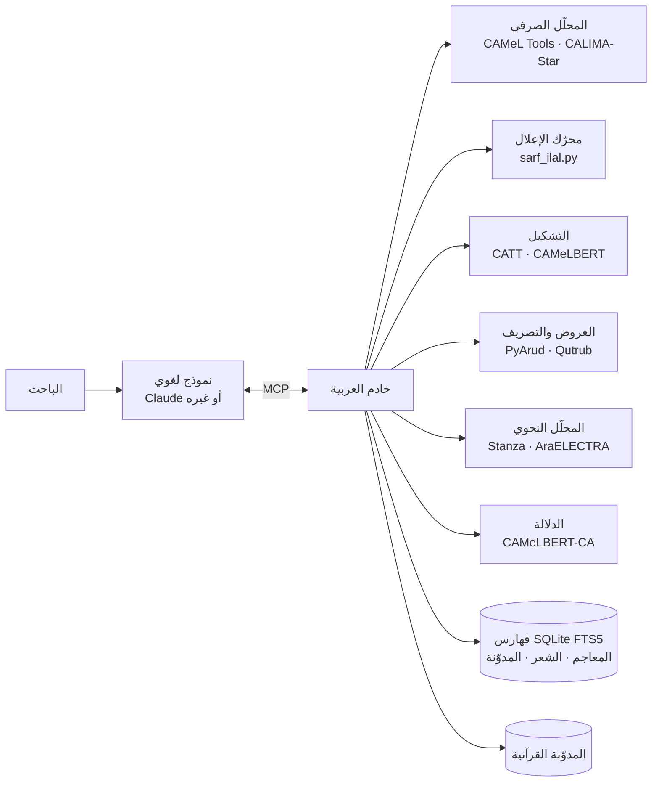

<p align="center">
  <picture>
    <source media="(prefers-color-scheme: dark)" srcset="brand/banner-dark.svg">
    <source media="(prefers-color-scheme: light)" srcset="brand/banner-light.svg">
    
  </picture>
</p>

<p align="center">
  <a href="LICENSE"></a>
  
  
  <a href="tests/test_ilal.py"></a>
  <a href="CITATION.cff"></a>
</p>

<div dir="rtl">

# العربية

**خادمٌ حاسوبي لعلوم العربية، يَصِل النماذجَ اللغوية بالمعاجم والمدوّنات والمحلّلات عبر بروتوكول سياق النموذج (MCP)، لتستند أجوبتها إلى مصدرٍ يُراجَع أو قاعدةٍ تُختبَر، لا إلى ما تستظهره.**

[الملخّص](#الملخّص) · [ما الأداة وما ليست](#ما-الأداة-وما-ليست) · [مراتب الأحكام](#مراتب-الأحكام) · [الأدوات](#الأدوات-ومناهجها) · [قياس الدقة](#قياس-الدقة) · [حدود المنهج](#حدود-المنهج) · [خطة التطوير](#خطة-التطوير) · [التثبيت](#التثبيت) · [شكر وتقدير](#شكر-وتقدير) · [English](#english-summary)

## الملخّص

النماذج اللغوية الكبيرة (Large Language Models) فصيحة العبارة في العربية، لكنها تجيب في مسائل علومها من محفوظها الإحصائي، فلا يتميّز في جوابها المنقولُ من المستنتَج ولا الصحيحُ من الموهوم. ويظهر ذلك في أخصّ مواضع الصنعة: وزنِ المعتلّ وبيانِ ما جرى فيه من إعلال، وتعيينِ البحر حين يختلّ الضبط، ونسبةِ الشاهد إلى قائله، ونقلِ نصّ المعجم بلفظه.

ويقوم هذا المشروع على **الفصل بين الصياغة والحكم**: يتولّى النموذج اللغوي فهمَ السؤال وصياغةَ الجواب، ويصدر الحكم نفسه عن أداةٍ معلومة المنهج. فالخادم يعرض على النموذج سبعًا وثلاثين أداةً في عشرة فروع من الدرس اللغوي، هي:

- الصرف والتصريف، والميزان الصرفي بخطوات الإعلال والإبدال والإدغام.
- النحو والإعراب.
- الضبط بالشكل، والعروض، وعلم القافية.
- الأصوات: المخارج والصفات، والكتابة الصوتية، والمقاطع.
- البديع.
- المعجم التراثي وكتب اللغة المتخصصة.
- الصرف القرآني.
- الشواهد الشعرية وتخريجها.
- الدلالة التوزيعية والتطور الدلالي.
- لسانيات المدوّنة والأسلوبية الإحصائية ونسبة النصوص.

وكل نتيجة تُعزى إلى مصدرها بالجزء والصفحة، أو إلى الأداة التي أنتجتها، ويصحب كل أداة بيانُ منهجها وحدودها. ويعمل الخادم على جهاز الباحث: تُنزَّل البيانات مرة واحدة، ثم تعمل الأدوات بلا اتصال بالشبكة، إلا أداتين تنصّان على ذلك.

## ما الأداة وما ليست

دفعًا لما قد يُتوهَّم من اسمها أو من صلتها بالذكاء الاصطناعي:

| ما قد يُتوهَّم | التحقيق |
|---|---|
| أنها نموذج لغوي عربي، أو تدريبٌ لـ Claude على العربية | ليست نموذجًا ولا تُغيّر نموذجًا. هي خادم أدوات يستدعيه النموذج كما يرجع الباحث إلى كتاب، وتعمل مع أي عميل يدعم البروتوكول |
| أن كل ما يقوله النموذج بعد ربطها صحيح | العبرة بمُخرَج الأداة لا بصياغة النموذج له. والنموذج قد يُجمِل النتيجة أو يُسيء نقلها، ومُخرَج كل استدعاء ظاهرٌ في تطبيق العميل لمن أراد مراجعته |
| أن نتائجها قطعية | أحكامها على ثلاث مراتب متفاوتة في الوثوق، مبيّنة في [مراتب الأحكام](#مراتب-الأحكام). وما كان منها ترجيحًا إحصائيًّا يُقدَّم بوجوهه ولا يُجزم به |
| أنها تُغني عن الرجوع إلى المصادر | هي أداة تقريب وكشف تختصر الطريق إلى الموضع، والتحقيق بعدها للباحث. فالمعاجم مثلًا تُنقل من نسخ OpenITI الرقمية، وهي غير محقّقة يدويًّا |
| أن أرقام الدقة المنشورة تصدق على كل نص | قيست على عينات محدودة معلنة، ويُعاد إنتاجها ببذرة العينة. ولا تُعمَّم على غير جنسها، كالشعر القديم إذا قيست على النثر |
| أن نصوص الباحث تُرسَل إلى خادم خارجي | تعمل الأدوات على جهازه. ويتصل بالشبكة `lexicon_lookup` (البحث في معاجم موقع خارجي) و`corpus_add_book` (تنزيل كتاب جديد) وحدهما |
| أن `sarf` في أسماء الملفات اسمٌ آخر للمشروع | هو الاسم الأول للمشروع حين اقتصر على الصرف، وبقي في أسماء الملفات ومجلد البيانات (`~/.sarf`) حفظًا للتوافق مع التثبيتات السابقة |

## مراتب الأحكام

ما تُخرجه الأدوات ليس من جنس واحد، فيُرتَّب بحسب مصدر الحكم، وبه تُقدَّر درجة الوثوق به وجهة الخطأ فيه:

| المرتبة | مصدر الحكم | جهة الخطأ | الأدوات |
|---|---|---|---|
| **١. النقل** | نصٌّ في مصدر معيّن، يُنقل بلفظه مع موضعه | خطأ النسخة الرقمية (التصحيف، ونقص النص)، أو خطأ تقطيع المعجم إلى مواد | `maajim` · `lughawiyyat` · `quran_word` · `quran_root` · `search_poetry` · `corpus_concordance` · `corpus_find_book` · `lexicon_lookup` |
| **٢. القاعدة** | قواعد صريحة على مذهب أهل الصنعة، تُعطي النتيجة نفسها كلما أُعيدت، وتُختبر بحالات معيارية | قاعدة ناقصة أو حالة لم تُستوعب، فتُصلَح القاعدة نفسها | `mizan` · `mushtaqqat` · `taqalib` · `conjugate` · `analyze_qafiya` · `huruf` · `phonetics` · `analyze_word` · `root_family` · `corpus_usage` · `corpus_collocates` · `usage_compare` · `text_profile` · `compare_texts` · `detect_badi` |
| **٣. الترجيح** | نموذج إحصائي مدرَّب، يرجّح بين وجوه بحسب ما رأى من بيانات | الخروج عن جنس بيانات التدريب (الشعر، والتراكيب النادرة)، فتُعرض النتيجة بوجوهها | `analyze_text` · `diacritize` · `scan_verse` · `scan_poem` · `irab` · `word_similarity` · `substitutes_in_context` · `semantic_neighbors` · `semantic_change` · `attribute_author` · `takhrij_shahid` |

**تنبيهات على التقسيم:**

- **الأدوات المركّبة:** بعض الأدوات يجمع مرتبتين. فالتقطيع العروضي قاعدةٌ إذا كان البيت مشكولًا شكلًا تامًّا، وترجيحٌ إذا شُكِّل آليًّا. والتخريج نقلٌ في نصوص الأبيات، وترجيحٌ في المطابقة بينها.
- **مرتبة القاعدة في الإحصاء:** ما في هذه المرتبة من أدوات المدوّنة حسابٌ معلوم الصيغة، لكن مدخلاته الصرفية (الجذر والوزن) قد تكون ترجيحًا. فيُنبَّه على ذلك في موضعه.
- **أدوات خارج المراتب:** ثلاث أدوات لا تُصدر حكمًا لغويًّا. فأداة `benchmark` تقيس دقة غيرها، وأداتا `corpus_add_book` و`corpus_remove_book` تُضيفان الكتب إلى المدوّنة وتحذفانها.

## البنية



البيانات كلها في قواعد SQLite محلية، وفيها فهرسة نصية كاملة (FTS5) على نصوص موحّدة الرسم:

- تُحذف الحركات.
- تُردّ الهمزات (أ إ آ ٱ) إلى الألف.
- تُكتب التاء المربوطة هاءً، والألف المقصورة ياءً.

## الموارد اللغوية

| المورد | المحتوى | الاستعمال |
|---|---|---|
| CALIMA-Star (calima-msa-r13) | قاعدة صرفية للفصحى المعاصرة فيها السوابق والجذوع واللواحق وسماتها | التحليل والتوليد الصرفي |
| CAMeLBERT-MSA (BERT unfactored) | نموذج إزالة الالتباس الصرفي بالسياق | الترجيح السياقي |
| CATT | مشكِّل على مستوى الحرف بمعمارية المحوِّل (Transformer)، رخصة Apache-2.0 | التشكيل |
| CAMeLBERT-CA | نموذج BERT مدرَّب على العربية الكلاسيكية | الدلالة التوزيعية |
| المدوّنة القرآنية (Quranic Arabic Corpus) | تحليل صرفي ونحوي لكلمات القرآن مقسّمة إلى أجزاء | الصرف القرآني، ومواضع الجذور، والقياس |
| مدوّنة «أشعار» (Ashaar) | 254,630 قصيدة و3,863,406 أبيات، بالشاعر والبحر والعصر والغرض | الشواهد، والتحليل الأسلوبي، والقياس |
| Tashkeela (Fadel et al., 2019) | نصوص تراثية مشكولة مقسومة للتدريب والاختبار | قياس التشكيل وتدريب مشكِّل الشعر |
| OpenITI: المعاجم | 15 معجمًا من العين (ت 170هـ) إلى تاج العروس (ت 1205هـ) | مادة الجذر بالجزء والصفحة |
| OpenITI: المدوّنة | 57 مصنَّفًا في النحو واللغة والبلاغة والشعر والأدب، من القرن الثاني إلى الحادي عشر، نحو 11.9 مليون كلمة | لسانيات المدوّنة |
| فهرس OpenITI | 8,792 نسخة أصلية (primary version) من نصوص عربية، بعناوينها ومؤلفيها | توسيع المدوّنة |
| OpenITI: كتب اللغة المتخصصة | الفروق اللغوية للعسكري، والأضداد لابن الأنباري، والقلب والإبدال لابن السكيت، والإبدال والإتباع لأبي الطيب، والتعريب لابن بري، والمهذب للسيوطي، والمثلثات للمهلبي | الفروق والأضداد والإبدال والمعرّب |
| Stanza + AraELECTRA | محلل نحوي بطريقة التبعية (dependency parsing) مدرَّب على شجرة PADT في Universal Dependencies (Qi et al., 2020؛ Antoun et al., 2021) | الإعراب |

**المعاجم الخمسة عشر:** العين، وجمهرة اللغة، وتهذيب اللغة، والصحاح، ومقاييس اللغة، ومجمل اللغة، والمحكم، والمفردات، وأساس البلاغة، والنهاية، ومختار الصحاح، ولسان العرب، والمصباح المنير، والقاموس المحيط، وتاج العروس.

**تقطيع المعاجم إلى مواد:** يجري بحسب طريقة كل معجم في الترتيب:

- **معاجم التقاليب** (العين والجمهرة والتهذيب والمحكم): تُفهرس المادة بمفتاح لا يتغير بترتيب الحروف، فتُستخرج من باب تقاليبها.
- **لسان العرب:** بعناوين مواده.
- **القاموس المحيط:** في حدود الباب والفصل.

ويُردّ كل موضع إلى الجزء والصفحة بحسب علامات الصفحات في نصوص OpenITI.

## الأدوات ومناهجها

### ١. الصرف والنحو

| الأداة | المنهج |
|---|---|
| `analyze_word` | التحليلات الممكنة كلها للكلمة المفردة من قاعدة CALIMA-Star، بلا ترجيح: الجذر والوزن والمدخل والجذع وقسم الكلم والسمات الصرفية |
| `analyze_text` | تحليل الجملة مع اختيار التحليل الأرجح بالسياق عبر مُزيل الالتباس المبني على BERT (Inoue et al., 2022) |
| `root_family` | المداخل المعجمية كلها في القاعدة الراجعة إلى جذر واحد، بأوزانها وأقسامها ومعانيها |
| `conjugate` | تصريف الفعل في الماضي والمضارع بأحواله الثلاثة والمؤكد والأمر، معلومًا ومجهولًا، عبر قطرب (Zerrouki). وتُستخرج حركة عين المضارع من صيغة المضارع في القاعدة الصرفية، ويُختار الفعل غير المشكول من مرشحات المعجم الصرفي بحسب مطابقة الرسم |

**حساب الوزن الصرفي:** صيغة CALIMA تشمل السوابق واللواحق، وتُبقي حرف العلة المنقلب ظاهرًا كما هو. فيُجرَّد الوزن أولًا من:

- أدوات الجر والعطف والتعريف.
- الضمائر المتصلة.
- علامة الإعراب.

ثم يُردّ المعتل والمضعّف إلى الميزان الصرفي المعروف:

| الكلمة | وزنها في القاعدة | الوزن بعد الردّ |
|---|---|---|
| قال | فال | فَعَل |
| يقول | يَفُول | يَفْعُل |
| بيت | فَيْل | فَعْل |
| رمى | فَعَى | فَعَل |
| اختار | افتال | افْتَعَل |
| قائل | فائل | فاعِل |
| مُدّة | فُعَّة | فُعْلَة |

**`mizan`: الميزان الصرفي وخطوات الإعلال.** محرّك قواعد (`sarf_ilal.py`) يعمل في الاتجاهين:

1. يُردّ رمز الحرف المعتل أو الهمزة في جذر CALIMA (`#`) إلى الواو أو الياء أو الهمزة. ويُرجَّح بينها بورود الجذر في المعاجم، ثم بورود الكلمة نفسها في مادته من اللسان والتاج والصحاح والقاموس والمقاييس.
2. تُجرَّب نحو مئة قالب قياسي للثلاثي ومزيده: الأفعال بأبوابها العشرة، والمصادر، والمشتقات، وجموع التكسير الشائعة. ويُبنى من كل قالب «الأصل» بوضع حروف الجذر فيه.
3. تُطبَّق قواعد الإعلال والإبدال والإدغام بترتيبها عند الصرفيين، وتُسجَّل كل خطوة بعبارتها:
   - نقل الحركة.
   - قلب حرف العلة ألفًا، وقلب الواو ياءً والياء واوًا.
   - الهمز بعد ألف فاعل، والهمز في التطرف.
   - حذف واو مفعول، على مذهب سيبويه ومع ذكر قول الأخفش.
   - اجتماع الواو والياء.
   - إبدال تاء الافتعال، وقلب فاء المثال تاءً.
   - حذف فاء المثال في المضارع.
   - إعلال المنقوص المنوّن.
   - إدغام المثلين، ومصدر الأجوف من أفعل واستفعل.
4. **التحقق الذاتي:** لا يُقبل القالب إلا إذا أعادت القواعدُ الأصلَ إلى الكلمة نفسها حرفًا وشدّةً وحركة.

ويُعرض بعد ذلك: الوزن الأصلي، والوزن على لفظ الكلمة (قائل: فائل، اتّصل: اِتَّعَل، يعد: يَعِل)، ونوع الجذر، ونوع الإعلال في كل خطوة.

| الكلمة | الأصل | الخطوات |
|---|---|---|
| مَقُول | مَقْوُول | نقل الحركة إلى القاف، ثم حذف واو مفعول لالتقاء الساكنين |
| مَبِيع | مَبْيُوع | نقل الحركة، ثم حذف واو مفعول، ثم كسر الباء لتصح الياء |
| مِيزان | مِوْزان | سكنت الواو بعد كسرة فقُلبت ياءً |
| اِتَّصَلَ | اِوْتَصَلَ | قُلبت فاء الافتعال تاءً وأُدغمت |
| مَرْمِيّ | مَرْمُوي | اجتمعت الواو والياء وسبقت إحداهما بالسكون فقُلبت ياءً وأُدغمت، وكُسر ما قبلها |
| اِسْتِقامَة | اِسْتِقْوام | نقل وقلب، ثم حذف إحدى الألفين والتعويض بالتاء |
| داعٍ | داعِوٌ | قُلبت الواو ياءً لتطرفها بعد كسرة، ثم حُذفت لالتقاء الساكنين |

وفي `tests/test_ilal.py` ثلاث وأربعون حالة معيارية من كتب الصرف تجتازها القواعد كلها.

**`mushtaqqat`:** يولّد المشتقات القياسية من الفعل بقوالبها، ثم بقواعد الإعلال نفسها:

- اسم الفاعل، واسم المفعول، والمصدر الميمي، واسما الزمان والمكان (مَفْعَل أو مَفْعِل بحسب عين المضارع وكون الفعل مثالًا).
- اسم الآلة، وصيغ المبالغة، واسم التفضيل، واسما المرة والهيئة.
- مصادر المزيد ومشتقاته.

ويُعلَّم كل مولَّد بأنه مستعمل في المعجم الصرفي أو قياسي لم يُسمع فيه.

**`taqalib`:** التباديل الستة للجذر الثلاثي (أو الأربعة والعشرون للرباعي)، ويُحكم بالاستعمال بورود التقليب في المعاجم المرتبة على الحروف. ولا يكفي ذكره في أبواب التقاليب، لأن الخليل يذكر فيها المهمل أيضًا.

**`irab`: الإعراب.** يُحلَّل النص بمحلل التبعية Stanza، بنموذج AraELECTRA المدرَّب على شجرة PADT، فيُستخرج لكل كلمة:

- قسمها.
- سماتها: الحالة الإعرابية، والتعريف والتنكير، والإعراب والبناء في الفعل، والبناء للمعلوم والمجهول.
- عاملها.
- علاقتها به.

ثم تُنقل العلاقات إلى أبواب النحو بقواعد:

| علاقة UD | الباب في النحو العربي |
|---|---|
| `nsubj` مع فعل | فاعل |
| `nsubj` مع فعل ناسخ | اسم كان أو اسم إنّ |
| `nsubj` في جملة اسمية | مبتدأ، وخبره رأس الجملة |
| `nsubj:pass` | نائب فاعل |
| `obj` | مفعول به |
| `amod` | نعت |
| `conj` | معطوف |
| `appos` | بدل |
| `nmod` في حالة الجر | مضاف إليه |
| مع حرف جر | اسم مجرور |
| `obl` منصوب | ظرف، أو مفعول مطلق إذا اتحد جذره بجذر الفعل، أو حال، أو مفعول لأجله أو تمييز بحسب المعنى |

وتُستخرج علامة الإعراب الأصلية أو الفرعية من صورة الكلمة:

- المثنى، وجمع المذكر السالم.
- جمع المؤنث السالم في النصب.
- الأسماء الخمسة.
- الأفعال الخمسة.
- المقصور والمنقوص، والمعتل الآخر في الجزم.

ثم يُقترح ضبط أواخر الكلمات بحسب مواقعها، وبهذا تُصحَّح علامات الإعراب في التشكيل الآلي.

### ٢. الضبط والعروض والقافية

| الأداة | المنهج |
|---|---|
| `diacritize` | التشكيل بمشكِّل CATT على مستوى الحرف، ويُرجَع إلى التحليل الأرجح سياقيًّا (CAMeL) عند تعذّره |
| `scan_verse` | التقطيع العروضي عبر PyArud: البحر، والتفعيلات، والزحافات والعلل، والقافية والروي |
| `scan_poem` | تقطيع القصيدة بيتًا بيتًا، وتحديد البحر والروي الغالبين، والتنبيه على كل بيت خالفهما أو اختل وزنه |

**أثر التشكيل في التقطيع:** التقطيع العروضي يتوقف على التشكيل التام، والتشكيل الناقص يُفسده. فيُقاس أولًا ما في البيت من تشكيل، أي نسبة الحركات إلى الحروف:

| نسبة التشكيل | المعالجة |
|---|---|
| أقل من 0.3 | يُشكَّل البيت آليًّا كله |
| من 0.3 إلى أقل من 0.85 | يُملأ الناقص من التشكيل الآلي، مع إبقاء ضبط الأصل حيث وُجد، كلمةً كلمة إذا تطابق رسم الكلمة في النصّين |
| 0.85 فأكثر | يُقطَّع البيت كما هو |

**التشكيل الموجَّه بالعروض.** إذا لم يستقم البيت بعد التشكيل، تُجمع لكل كلمة ضبوطها الممكنة:

- تحليلات المحلل الصرفي.
- بدائل حركة الآخر: الحركات الثلاث، والتنوين، والسكون.
- إشباع هاء الكناية، وصلة ميم الجمع.

وكلها مقيّدة بما ضبطه صاحب النص.

ثم يُبحث بالعمق مع التقليم عن أقل عدد من التغييرات يجعل نمط الشطر من الأنماط الصحيحة لبحره. وأنماط البحور مأخوذة من نحو البحور في PyArud بزحافاتها وعللها، وتُقلَّم كل بادئة لا تفضي إلى نمط صحيح.

ويُعرض كل تغيير للباحث، وهو «ضبط يقتضيه الوزن، لا رواية محققة».

وفي هذه المرحلة أُصلحت علّتان:

- **شدة الحرف الشمسي:** يغفلها ضبط CAMeL بعد «ال»، فيسقط بسقوطها مقطع، فصارت تُثبَت.
- **قاعدة «يس ← ياسين» في PyArud:** كانت تُطبَّق على آخر «ليس» و«وليس» فتفسد وزنهما.

**`analyze_qafiya`: علم القافية.** تُحدَّد عناصر القافية لكل بيت بقواعد العروضيين:

- الروي، بعد استبعاد ألف الإطلاق وواوه ويائه، وهاء الوصل إذا تحرك ما قبلها.
- الوصل والخروج.
- الردف.
- التأسيس، بشرط كونه في كلمة الروي، والدخيل.
- الحركات: المجرى، والنفاذ، والحذو، والإشباع، والرس، والتوجيه.

ويُرجَّح الروي على مستوى القصيدة كلها، إذا احتمل البيت الواحد أكثر من روي.

ثم تُرصد العيوب:

- **الإقواء والإصراف:** اختلاف المجرى.
- **الإكفاء والإجازة:** اختلاف الروي بحرف متقارب المخرج أو متباعده.
- **سناد الردف:** ومن صوره تعاقب الألف مع الواو أو الياء، أما تعاقب الواو والياء فجائز.
- **سناد التأسيس، وسناد الإشباع، وسناد الحذو، وسناد التوجيه.**
- **الإيطاء:** تكرار كلمة القافية، مع حساب المسافة بين التكرارين وحدّ السبعة الأبيات.

### ٣. البلاغة

**`detect_badi`:** يرصد مرشحات المحسنات البديعية:

| النوع | طريقة الرصد |
|---|---|
| الجناس التام | تطابق الحروف واختلاف المدخل المعجمي |
| الجناس المحرّف | اختلاف الحركات وحدها |
| الجناس المضارع واللاحق | اختلاف حرف واحد متقارب المخرج أو متباعده (بجدول المخارج في `huruf`) |
| الجناس الناقص | زيادة حرف |
| جناس الاشتقاق | اتحاد الجذر |
| طباق الإيجاب | بمعجم أضداد مختار |
| طباق السلب | الإثبات والنفي للمدخل نفسه |
| المقابلة | زوجان متضادان فأكثر |
| التصريع | اتفاق روي الصدر والعجز |
| ردّ العجز على الصدر | تكرار كلمة القافية أو جذرها في الصدر |
| لزوم ما لا يلزم | التزام حرف قبل الروي في القصيدة |
| السجع المطرَّف والمتوازي | اتفاق الفاصلتين رويًّا، واتفاقهما وزنًا في المتوازي |
| الاقتباس | اتفاق أربع كلمات متتالية فأكثر مع النص القرآني |

### ٤. الأصوات

**`phonetics`: تحويل الحروف إلى أصوات بالقواعد.** يحوّل النص المشكول إلى كتابة صوتية وظيفية (phonemic) بالأبجدية الصوتية الدولية (IPA)، مع مراعاة:

- همزة الوصل: تُنطق في الابتداء وتسقط في الدرج.
- اللام الشمسية والقمرية.
- التنوين.
- التقاء الساكنين: يُقصَّر المدّ ويُحرَّك الساكن.
- الوقف: بالسكون، وعلى تنوين النصب ألفًا، وعلى التاء المربوطة هاءً.
- الألف الفارقة.
- الألف المحذوفة رسمًا: هذا، ذلك، لكن، الله، إله، الرحمن، السماوات.

**التقطيع إلى مقاطع:** يبدأ كل مقطع بصامت واحد، وأنواع المقاطع خمسة:

| النوع | الوصف |
|---|---|
| CV | قصير |
| CVV | طويل مفتوح |
| CVC | طويل مغلق |
| CVVC | مديد |
| CVCC | مديد |

وتُقابَل المقاطع برموزها العروضية: `/` للمتحرك و`0` للساكن.

**النبر:** يُعطى تقريبيًّا بقاعدة الفصحى المعاصرة (Ryding, 2005):

- يقع على المقطع الأخير إن كان مديدًا.
- وإلا فعلى ما قبل الأخير إن كان طويلًا.
- وإلا فعلى الثالث من الآخر.

**`huruf`: المخارج والصفات.**

- **المخارج:** السبعة عشر على مذهب ابن الجزري في المقدمة الجزرية.
- **الصفات التي لها ضد:** الجهر والهمس، والشدة والتوسط والرخاوة، والاستعلاء والاستفال، والإطباق والانفتاح، والإذلاق والإصمات.
- **الصفات التي لا ضد لها:** الصفير، والقلقلة، والانحراف، والتكرير، والتفشي، والاستطالة، والغنة، واللين.
- **الوصف الصوتي الحديث:** موضع النطق، وطريقته، والرمز الدولي.
- **الموازنة بين حرفين:** تُصنَّف العلاقة بينهما بمصطلح أهل الأداء:
  - متجانسان: اتحدا مخرجًا.
  - متقاربان مخرجًا: تجاور مخرجاهما.
  - متقاربان صفةً.
  - متباعدان.
- **الخلاف بين الوصفين القديم والحديث:** يُنبَّه عليه، كجهر الطاء والقاف عند سيبويه، وجانبية الضاد القديمة.

### ٥. المعجم والقرآن والشعر

| الأداة | المنهج |
|---|---|
| `maajim` | مادة الجذر من المعاجم الخمسة عشر، مرتبةً بوفيات مؤلفيها، بالجزء والصفحة. وفي معاجم التقاليب يبدأ النص من موضع المادة داخل بابها |
| `lexicon_lookup` | البحث في نحو 47 معجمًا عربيًّا وعربيًّا إنجليزيًّا في موقع The Arabic Lexicon (يلزمه اتصال) |
| `quran_word` | أجزاء كل كلمة في الآية: النوع، والجذر، والصيغة، والسمات، والإعراب (Dukes & Habash, 2010) |
| `quran_root` | مواضع الجذر في القرآن، وصيغه وعدد كلٍّ منها |
| `search_poetry` | البحث النصي في مدوّنة «أشعار» بتوحيد الرسم، مع التقييد بالشاعر أو البحر أو العصر |
| `takhrij_shahid` | تخريج البيت: يُبحث عنه بفهرس «أشعار» ثم يُرتَّب بالتطابق اللفظي (SequenceMatcher على الكلمات الموحّدة الرسم)، فتُذكر نسبته، واختلاف روايته كلمةً كلمة، واختلاف نسبته، ويُفصل ذلك عن المعارضات والتضمين. ثم تُطلب مواضعه في كتب المدوّنة بثلاثيات الكلمات، ويُتحقق من كل موضع بنسبة ما يغطيه من ألفاظ البيت، ويُستخرج قول المؤلف «والشاهد فيه...» إن وُجد |
| `lughawiyyat` | البحث في كتب الفروق والأضداد والإبدال والإتباع والمعرّب والمثلثات وفقه اللغة، بالجزء والصفحة |

### ٦. الدلالة التوزيعية

تعتمد على نموذج CAMeLBERT-CA (Inoue et al., 2021). وتمثيل الكلمة هو متوسط الطبقات الأربع الأخيرة من النموذج، على الأجزاء التي يقطّعها إليها، مُطبَّعًا (normalized).

| الأداة | المنهج |
|---|---|
| `word_similarity` | جيب التمام بين تمثيلَي الكلمتين، إما منفردتين وإما في سياقَي جملتين، وبالثاني يُميَّز بين معاني المشترك اللفظي |
| `substitutes_in_context` | تُحجب الكلمة في جملتها ويُطلب من النموذج ما يصلح مكانها (masked language modeling) |
| `semantic_neighbors` | أقرب المفردات إلى الكلمة في معجم النموذج (نحو 21,500 مفردة) |

**`semantic_change`: التطور الدلالي.** تُقسم المدوّنة إلى حقب بالقرون الهجرية، ويُحسب لكل حقبة:

- تكرار اللفظ لكل مليون كلمة.
- متلازماته بنسبة الأرجحية.
- تداخل متلازمات الحقب المتتالية بمعامل جاكار، وما استجدّ منها وما غاب.
- الابتعاد السياقي: متوسط تمثيل اللفظ في سياقاته من كل حقبة بنموذج CAMeLBERT-CA، والبعد بين المتوسطات، على طريقة Giulianelli et al. (2020) مبسّطةً.

مثاله «الاستعارة»:

| الحقبة | أقوى المتلازمات |
|---|---|
| القرن 2–4 | «أبلغ»، و«حقيقته» |
| القرن 5–7 | «الكناية»، و«التمثيل»، و«التشبيه» |
| القرن 8–11 | «التخييلية»، و«التحقيقية»، و«التبعية» |

وفي هذا أثر استقرار المصطلح البلاغي وتفريعه.

**معالجة تقارب الاتجاهات في `semantic_neighbors`:** تمثيلات نماذج BERT خارج السياق تتجه كلها إلى جهة واحدة تقريبًا (anisotropy)، فيتقارب جيب التمام بين أي كلمتين. ويُخفَّف ذلك بطرح متوسط المتجهات (mean-centering) على نحو ما في Mu & Viswanath (2018).

### ٧. لسانيات المدوّنة

| الأداة | المنهج |
|---|---|
| `corpus_concordance` | السياقات بطريقة KWIC، مقيّدةً بالفن أو القرن أو الكتاب، مع إمكان شمول السوابق (و، ف، ب، ك، ل، وال...) |
| `corpus_usage` | ورود اللفظ في كل قرن هجري بحسب وفاة المؤلف، مُطبَّعًا لكل مليون كلمة من نصوص ذلك القرن، مع توزّعه على الفنون والكتب |
| `corpus_collocates` | المتلازمات في نافذة ±k: نسبة الأرجحية (Log-likelihood) على جدول توافق 2×2 (Dunning, 1993)، مع المعلومات المتبادلة النقطية PMI (Church & Hanks, 1990)، بعد حذف حروف المعاني |
| `corpus_find_book` | البحث في فهرس OpenITI العربي بالعنوان أو المؤلف |
| `corpus_add_book` / `corpus_remove_book` | تنزيل نص من OpenITI وتقطيعه إلى فقرات وفهرسته وتحديث جدول التكرار، أو حذفه وحذف أثره من الفهرس والتكرار |
| `usage_compare` | موازنة تعبيرين أو أكثر (مسائل التعدية والاستعمال): الورود، والنسبة لكل مليون كلمة، والتوزع على الفنون والقرون، والشواهد |

### ٨. الأسلوبية الإحصائية

**`text_profile`:** يصف نصًّا أو ديوانًا بـ:

- عدد الكلمات وأنواعها، والكلمات المفردة الورود (hapax legomena).
- أكثر الجذور والمداخل والأوزان ورودًا.
- توزّع أقسام الكلم.

**`compare_texts`:** يوازن بين جانبين. وكل جانب نصٌّ معطى، أو ديوان شاعر، أو كتاب من المدوّنة. ويُخرج:

- **الإبانة (keyness):** ما يختص به كل جانب من الألفاظ والجذور والأوزان. يُقاس بنسبة الأرجحية (Rayson & Garside, 2000) بعتبة 10.83 (p < 0.001)، مع نسبة اللوغاريتم Log Ratio لقياس حجم الفرق (Hardie, 2014)، وفيها تمهيد بـ 0.5 للأصفار.
- **ثراء المعجم:** نسبة الأنواع إلى الكلمات المعيارية (STTR)، وهي متوسط النسبة في كل ألف كلمة، فلا تتأثر بتفاوت طول النصّين.
- **التداخل المعجمي:** معامل جاكار (Jaccard) للألفاظ وللجذور.
- **المعجم المشترك:** مرتبًا بأدنى التكرارين النسبيين.

**`attribute_author`: نسبة النص إلى قائله.** تُحسب نسب أكثر الألفاظ دورانًا، وجلّها حروف المعاني والضمائر. ثم تُحوَّل إلى درجات معيارية بمتوسط مقاطع نصوص المرشحين وانحرافها، ويُقاس البعد بين النص وكل مرشح بمقياسين:

- **Delta:** مقياس Burrows (2002).
- **Cosine Delta:** مقياس Smith & Aldridge (2011).

والنتيجة قرينة إحصائية تُضمّ إلى أدلة النسبة الأخرى.

## قياس الدقة

أداة `benchmark` تقيس الدقة على بيانات معيارية محلية، ويُعاد إنتاج كل رقم ببذرة العينة. وفي التشكيل مقياسان:

- **DER** (Diacritic Error Rate): نسبة الحروف التي أخطأ المشكِّل حركتها.
- **WER** (Word Error Rate): نسبة الكلمات التي فيها خطأ واحد على الأقل.

| المهمة | البيانات | المقياس | النتيجة |
|---|---|---|---|
| الميزان والإعلال | 43 حالة معيارية من كتب الصرف (`tests/test_ilal.py`) | مطابقة الأصل والصورة | 43/43 |
| استخراج الجذر | 2,000 كلمة عشوائية من القرآن (المدوّنة القرآنية) | الجذر بأرجح تحليل بلا سياق | 78.8% (والصحيح بين التحليلات الممكنة 81.7%) |
| التشكيل (CATT) | 40 سطرًا نثريًّا من قسم الاختبار في Tashkeela | DER / WER | 1.1% / 2.9% |
| التشكيل (CATT) | 40 بيتًا مشكولًا من «أشعار» | DER / WER | 15.2% / 33.9% |
| التقطيع بالضبط الموجَّه | 210 أبيات من 14 بحرًا، منزوعة التشكيل ومشكولة بأرجح تحليل بلا سياق | الأبيات الموزونة | من 1.9% إلى 31.4% |
| نسبة النص إلى قائله | 30 شاعرًا من «أشعار»، ونص مختبر من نحو 1500 كلمة معزول عن شعر صاحبه بعد حذف المكرر | Cosine Delta على 150 لفظًا | 96.7% (خط الأساس 3.3%) |

**قراءة الأرقام:**

- **التشكيل بين النثر والشعر:** الفرق بينهما في التشكيل هو علّة الضبط الموجَّه بالعروض. فالمشكِّل يُحسن النثر ويضعف في الشعر، فيُكمَّل ضبطُ الأبيات بما يقتضيه الوزن. وقياس التقطيع بالمشكِّل الحالي يُجرى بـ `benchmark("meter")`.
- **نسبة النصوص:** قيست على شعراء أكثرهم معاصرون متمايزو المعجم، فلا تُعمَّم على الشعر القديم.
- **التقطيع:** في «أشعار» قصائد مكررة وأبيات مختلّة، فأرقام التقطيع حدٌّ أدنى.
- **الإعراب والبديع والدلالة:** لم تُقَس بعدُ لفقد مجموعات اختبار عربية مصحّحة على مصطلح النحو العربي. وهذا من أول ما في [خطة التطوير](#خطة-التطوير).

**مشكِّل الشعر:** في المشروع نموذج اختياري لتشكيل الشعر (BiLSTM على مستوى الحرف)، يُدرَّب على جهاز الباحث على Tashkeela وأبيات «أشعار» المشكولة، بـ `train_diacritizer.py` أو `train_diacritizer.bat` على ويندوز. ولا يستعمله الخادم إلا إذا كان خطؤه على أبيات الاختبار أقل من خطأ CATT، ويُكتب تقرير الموازنة في `~/.sarf/models/diac_ca/report.txt`.

## حدود المنهج

1. **أصل القاعدة الصرفية:** CALIMA-Star مبنية للفصحى المعاصرة، فقد يغيب عنها بعض الغريب التراثي، أو يُرجَّح فيه معنى معاصر.
2. **التشكيل الآلي:** يُحسن النثر ويضعف في الشعر (انظر القياس)، والأولى إدخال الشعر مشكولًا لصحة التقطيع والتحليل الصوتي. وما يُضبط بمقتضى الوزن يُعرض على أنه «ضبط يقتضيه الوزن، لا رواية محقّقة».
3. **التحليل في الإحصاءات الأسلوبية:** الجذور والأوزان فيها هي أرجح تحليل لكل نوع (type) منفردًا بلا سياق، فالأرقام تقديرية تصلح للمقارنة النسبية دون العدّ القاطع.
4. **نصوص OpenITI:** أكثرها غير مشكول ولم يُراجَع يدويًّا، وبعض نسخها ناقص. والجزء والصفحة بحسب الطبعة التي في المكتبة الشاملة.
5. **تمثيل المدوّنة:** المدوّنة مختارة لا شاملة، وأحجام القرون فيها متفاوتة. فالتطبيع لكل مليون كلمة أدقّ من العدد المجرد، ولا يُعمَّم الحكم على العربية كلها.
6. **عدّ الألفاظ:** يُعدّ اللفظ في المدوّنة بصورته بعد توحيد الرسم، دون تجريد سوابقه.
7. **الكتابة الصوتية:** وظيفية لا نطقية، فلا تُظهر التفخيم في الحركات ولا الإخفاء والإقلاب ونحوهما من أحكام التجويد. والنبر لم يصفه القدماء، فهو تقريب بقاعدة معاصرة.
8. **الإعراب:** المحلل النحوي مدرَّب على لغة الصحافة المعاصرة (PADT)، فتقلّ دقته في الشعر والتقديم والتأخير. وتمييز الحال من التمييز ومن المفعول لأجله يتوقف على المعنى، فيُذكر بوجوهه.
9. **البديع:** ما يقوم على المعنى الخفي، كالتورية والاستخدام، لا يُرصد. والطباق محصور في معجم الأضداد المختار، والمرصود مرشّحات يُنظر فيها لا أحكام.
10. **نسبة النصوص:** تضعف إذا قصر النص عن ألف كلمة، أو اختلف عصر المرشحين أو فنّهم. ونتيجتها قرينة تُضمّ إلى غيرها من أدلة النسبة.

## خطة التطوير

المشروع قائم ومستمر، وغايته أن يبلغ في كل فرع درجةً يُعتمد عليها في البحث، بقياسٍ معلَن لا بدعوى. وهذه مراحله:

**أُنجز:**

- [x] سبع وثلاثون أداة في عشرة فروع، بمناهجها وحدودها.
- [x] محرّك قواعدي للإعلال والإبدال والإدغام يتحقق من نتيجته بنفسه، مع 43 حالة معيارية.
- [x] التقطيع بالضبط الموجَّه بالعروض، وعلم القافية بعيوبه.
- [x] التخريج الآلي للشاهد الشعري، ونسبة النصوص بمقاييس Delta.
- [x] أداة قياس الدقة على بيانات معيارية معلنة.

**قيد العمل:**

- [ ] تدريب مشكِّل خاص بالشعر، يُعتمد إن فاق CATT في القياس.
- [ ] استضافة الخادم على الشبكة، ليُستعمل موصلًا دون تثبيت.
- [ ] ملف تثبيت رسومي لويندوز يربط الأداة بـ Claude تلقائيًّا.

**مخطط:**

- [ ] مجموعة اختبار للإعراب مصحّحة يدويًّا بمصطلح النحو العربي، تُقاس عليها الأداة ويُنشر القياس.
- [ ] توسيع حالات الإعلال المعيارية إلى أبواب الصرف كلها (التصغير، والنسب، والجموع).
- [ ] قياس التقطيع على أبيات مشكولة محقّقة، وقياس الرصد البديعي على شواهد كتب البلاغة.
- [ ] تقويم بشري للنتائج يشارك فيه متخصصون في النحو والصرف والعروض.
- [ ] ورقة علمية تصف المنهج ونتائج القياس.

## الإسهام والتواصل

يُرحَّب بملاحظات أهل الاختصاص، فهي أنفع ما يُصلح الأداة. والملاحظة النافعة تُرسَل في [Issues](https://github.com/Sayedforces2021/arabiyya-mcp/issues) وفيها:

1. النص المُدخَل كما هو.
2. اسم الأداة.
3. ما أخرجته.
4. الصواب، ومصدره من كتب الصنعة إن أمكن.

وكل خطأ قاعدي يُبلَّغ عنه يُضاف بعد إصلاحه إلى الحالات المعيارية، فلا يعود.

## التثبيت

**المتطلبات:**

- تطبيق [Claude Desktop](https://claude.ai/download) أو أي عميل يدعم MCP.
- ويندوز 10/11 أو macOS.
- نحو 3 غيغابايت من المساحة.
- اتصال بالشبكة عند التثبيت لتنزيل البيانات.

| النظام | الخطوات |
|---|---|
| ويندوز | نزّل المستودع (Code ← Download ZIP)، ثم شغّل `install_sarf_windows.bat`، ثم أعد تشغيل Claude |
| macOS | ضع المستودع في مجلد دائم، ثم شغّل `install_sarf.command`، ثم أعد تشغيل Claude |

**ما يفعله سكربت التثبيت:**

1. يثبّت Miniconda إن لم يكن موجودًا (وعلى ويندوز Node.js أيضًا).
2. ينشئ بيئة Python 3.11.
3. يثبّت المكتبات.
4. ينزّل بيانات CAMeL والنماذج.
5. يبني الفهارس في مجلد `~/.sarf`.
6. يضيف الخادم إلى إعدادات Claude باسم `arabiyya`.

وإعادة تشغيله آمنة: يتخطى ما سبق تجهيزه، ولا يمسّ الكتب المضافة إلى المدوّنة.

**التشغيل اليدوي في أي عميل MCP:**

<div dir="ltr">

```json
{
  "mcpServers": {
    "arabiyya": { "command": "<python-of-env>", "args": ["<path>/sarf_mcp.py"] }
  }
}
```

</div>

ويعمل الخادم بنقل HTTP المتدفّق (streamable HTTP) إذا عُيِّن متغير البيئة `SARF_SECRET`، وبه تكون الاستضافة.

## قابلية إعادة الإنتاج

| الملف | عمله |
|---|---|
| `sarf_mcp.py` | الخادم والأدوات |
| `sarf_ilal.py` | محرّك الميزان الصرفي وقواعد الإعلال والإبدال والإدغام وقوالب الصيغ |
| `setup_sarf_data.py` | تجهيز البيانات بخطوات مستقلة يتخطى كلٌّ منها ما سبق إنجازه |
| `build_lexicon_index.py` | بناء فهرس المعاجم وقواعد تقطيع كل معجم |
| `build_poetry_index.py` | بناء فهرس «أشعار» |
| `build_corpus_index.py` | قائمة كتب المدوّنة بفنونها ومعرّفاتها في OpenITI، وبناء فهرسها |
| `diac_model.py` · `train_diacritizer.py` | نموذج مشكِّل الشعر وتدريبه وقياسه بالموازنة مع CATT |
| `tests/test_ilal.py` | الحالات المعيارية لمحرّك الإعلال |
| `openiti_catalog.tsv` | فهرس النسخ الأصلية العربية في OpenITI، مستخرج من بيانات `kitab-metadata-automation` |
| `brand/` | هوية المشروع: الختم والشعار واللافتات |

## شكر وتقدير

قام هذا المشروع على أعمالٍ مفتوحة أتاحها أصحابها للباحثين، ولولاها ما كان. فالشكر لهم، والفضل في كل نتيجة صحيحة لما بنوه، وما وقع من خطأ فعلى هذا المشروع لا عليهم.

| الجهة | ما استُعمل من عملها | الرابط |
|---|---|---|
| مختبر CAMeL، جامعة نيويورك أبوظبي | CAMeL Tools، وقاعدة CALIMA-Star الصرفية، ونماذج CAMeLBERT | [github.com/CAMeL-Lab/camel_tools](https://github.com/CAMeL-Lab/camel_tools) |
| Abjad AI (فارس الأسمري وزملاؤه) | مشكِّل CATT | [github.com/abjadai/catt](https://github.com/abjadai/catt) |
| فريق ARBML (زيد اليافعي وماجد الشيباني وزملاؤهما) | مدوّنة «أشعار» | [huggingface.co/datasets/arbml/ashaar](https://huggingface.co/datasets/arbml/ashaar) |
| شعيب النمري (Chouaieb Nemri) | مكتبة PyArud للتقطيع العروضي | [pypi.org/project/pyarud](https://pypi.org/project/pyarud/) |
| طه زروقي | قطرب لتصريف الأفعال، ومدوّنة Tashkeela | [github.com/linuxscout](https://github.com/linuxscout) |
| علي فاضل وزملاؤه | التقسيم المعياري لـ Tashkeela للتدريب والاختبار | [github.com/AliOsm/arabic-text-diacritization](https://github.com/AliOsm/arabic-text-diacritization) |
| مبادرة OpenITI ومشروع KITAB | المعاجم التراثية، ومدوّنة الكتب، وفهرس النصوص | [openiti.org](https://openiti.org) |
| كايس دوكس، جامعة ليدز | المدوّنة القرآنية (Quranic Arabic Corpus)، في نسخة mustafa0x المصحّحة | [corpus.quran.com](https://corpus.quran.com) |
| مجموعة ستانفورد لمعالجة اللغات الطبيعية | محلّل Stanza النحوي | [stanfordnlp.github.io/stanza](https://stanfordnlp.github.io/stanza/) |
| مختبر MIND، الجامعة الأمريكية في بيروت | نموذج AraELECTRA | [github.com/aub-mind/arabert](https://github.com/aub-mind/arabert) |
| إكرام هورامي | موقع The Arabic Lexicon | [arabiclexicon.hawramani.com](https://arabiclexicon.hawramani.com) |
| Anthropic | بروتوكول سياق النموذج (MCP) وتطبيق Claude | [modelcontextprotocol.io](https://modelcontextprotocol.io) |
| المكتبة الشاملة | أصل كثير من نصوص OpenITI | [shamela.ws](https://shamela.ws) |

وكذلك المكتبات العامة التي تقوم عليها النماذج والفهارس: PyTorch، وHugging Face Transformers، وONNX Runtime، وSQLite.

## المراجع

<div dir="ltr">

- Alasmary, F., Zaafarani, O., & Ghannam, A. (2024). CATT: Character-based Arabic Tashkeel Transformer. *arXiv:2407.03236*.
- Alyafeai, Z., Al-Shaibani, M. S., & Ahmed, M. (2023). Ashaar: Automatic analysis and generation of Arabic poetry using deep learning approaches. *arXiv:2307.06218*.
- Antoun, W., Baly, F., & Hajj, H. (2021). AraELECTRA: Pre-training text discriminators for Arabic language understanding. *Proceedings of WANLP 2021*.
- Burrows, J. (2002). 'Delta': A measure of stylistic difference and a guide to likely authorship. *Literary and Linguistic Computing*, 17(3), 267–287.
- Church, K. W., & Hanks, P. (1990). Word association norms, mutual information, and lexicography. *Computational Linguistics*, 16(1), 22–29.
- Dukes, K., & Habash, N. (2010). Morphological annotation of Quranic Arabic. *Proceedings of LREC 2010*.
- Dunning, T. (1993). Accurate methods for the statistics of surprise and coincidence. *Computational Linguistics*, 19(1), 61–74.
- Fadel, A., Tuffaha, I., Al-Jawarneh, B., & Al-Ayyoub, M. (2019). Arabic text diacritization using deep neural networks. *Proceedings of ICCAIS 2019*.
- Giulianelli, M., Del Tredici, M., & Fernández, R. (2020). Analysing lexical semantic change with contextualised word representations. *Proceedings of ACL 2020*.
- Hardie, A. (2014). Log Ratio – an informal introduction. ESRC Centre for Corpus Approaches to Social Science (CASS).
- Inoue, G., Alhafni, B., Baimukan, N., Bouamor, H., & Habash, N. (2021). The interplay of variant, size, and task type in Arabic pre-trained language models. *Proceedings of WANLP 2021*.
- Inoue, G., Khalifa, S., & Habash, N. (2022). Morphosyntactic tagging with pre-trained language models for Arabic and its dialects. *Findings of ACL 2022*.
- Mu, J., & Viswanath, P. (2018). All-but-the-top: Simple and effective postprocessing for word representations. *ICLR 2018*.
- Nigst, L., Romanov, M., Savant, S. B., Seydi, M., & Verkinderen, P. *OpenITI: A Machine-Readable Corpus of Islamicate Texts*. Zenodo.
- Obeid, O., Zalmout, N., Khalifa, S., Taji, D., Oudah, M., Alhafni, B., Inoue, G., Eryani, F., Erdmann, A., & Habash, N. (2020). CAMeL Tools: An open source Python toolkit for Arabic natural language processing. *Proceedings of LREC 2020*.
- Qi, P., Zhang, Y., Zhang, Y., Bolton, J., & Manning, C. D. (2020). Stanza: A Python natural language processing toolkit for many human languages. *Proceedings of ACL 2020: System Demonstrations*.
- Rayson, P., & Garside, R. (2000). Comparing corpora using frequency profiling. *Proceedings of the Workshop on Comparing Corpora, ACL 2000*.
- Ryding, K. C. (2005). *A Reference Grammar of Modern Standard Arabic*. Cambridge University Press.
- Smith, P. W. H., & Aldridge, W. (2011). Improving authorship attribution: Optimizing Burrows' Delta method. *Journal of Quantitative Linguistics*, 18(1), 63–88.
- Taji, D., Khalifa, S., Obeid, O., Eryani, F., & Habash, N. (2018). An Arabic morphological analyzer and generator with copious features. *Proceedings of SIGMORPHON 2018*.
- Zerrouki, T., & Balla, A. (2017). Tashkeela: Novel corpus of Arabic vocalized texts, data for auto-diacritization systems. *Data in Brief*, 11, 147–151.
- Zerrouki, T. *Qutrub: Arabic verb conjugator*. https://github.com/linuxscout/qutrub
- *PyArud*: Arabic prosody analyzer. https://pypi.org/project/pyarud/

</div>

**ومن المصادر التراثية:**

- سيبويه، *الكتاب*: باب الإدغام (في مخارج الحروف وصفاتها)، وأبواب الإعلال والإبدال.
- ابن جني، *سر صناعة الإعراب*، و*المنصف شرح التصريف*، و*الخصائص* (باب الاشتقاق الأكبر).
- رضي الدين الأستراباذي، *شرح الشافية* (في الإعلال والإدغام).
- الأخفش، *القوافي*؛ والتبريزي، *الكافي في العروض والقوافي* (في عناصر القافية وعيوبها).
- الخليل، *العين* (في التقاليب).
- ابن الجزري، *المقدمة الجزرية*، و*النشر في القراءات العشر*.

## المؤلف والإفصاح

صمّم المشروعَ وحدّد فروعه ومناهجه ومصادره سيد حسن، وكُتبت شيفرته بمعونة نموذج Claude من Anthropic، بتوجيه المؤلف ومراجعته. ويُذكر ذلك لأن أداةً غايتها التمييز بين مصادر الأحكام أولى بأن تُبيّن مصدر صنعتها.

## طريقة الاستشهاد

<div dir="ltr">

```bibtex
@software{arabiyya_mcp_2026,
  author  = {Sayed Hassan},
  title   = {arabiyya: A Model Context Protocol server for Arabic linguistic research},
  year    = {2026},
  version = {1.0.0},
  url     = {https://github.com/Sayedforces2021/arabiyya-mcp},
  license = {MIT}
}
```

</div>

ويُستشهد كذلك بالموارد التي اعتمدت عليها الأداة المستعملة (انظر [المراجع](#المراجع)).

## الرخص

- **الشيفرة:** مرخّصة برخصة MIT (انظر `LICENSE`).
- **البيانات:** لا تتضمن الشيفرة شيئًا من البيانات، وإنما تنزّلها من مصادرها عند التثبيت.
- **النماذج والمدوّنات:** تخضع لشروط ناشريها، وأكثرها للاستعمال البحثي غير التجاري.
- **الهوية:** الختم والشعار في `brand/` خاصّان بالمشروع، ويُستعملان للإشارة إليه.

</div>

---

## English summary

**arabiyya** is a Model Context Protocol (MCP) server that exposes 37 tools for Arabic linguistic research to LLM clients such as Claude Desktop. Its premise is a separation of *phrasing* from *judgement*: the language model reads the question and words the answer, while each judgement comes from a tool with a stated method. Outputs are cited to a source (volume and page) or to the tool that produced them. The server runs locally and, after a one-time data download, works offline.

**What it is not.** It is not a language model and does not fine-tune one. Its outputs are not infallible, and a client model may still misreport them; the raw output of every call is visible in the client. Published accuracy figures hold for the stated samples only.

**Three tiers of evidence.** Every tool is classed by where its judgement comes from:
1. **Transmission**: verbatim text from a located source (dictionaries, specialized lexical works, the Qur'an, poetry, the corpus).
2. **Rule**: deterministic rules after the classical grammarians, tested against gold cases (*i'lāl*, derivation, rhyme, phonetics).
3. **Inference**: trained statistical models whose output is offered with alternatives (contextual analysis, diacritization, *i'rāb*, semantics, attribution).

**Morphology**
- Context-free and BERT-disambiguated analysis (CAMeL Tools, CALIMA-Star), root families, and verb conjugation (Qutrub).
- A rule-based *i'lāl/ibdāl/idghām* engine (`sarf_ilal.py`) that reconstructs the underlying form (*aṣl*) of a word and derives its surface form step by step, in the terminology of classical grammarians. Each derivation is self-verified, and the engine passes 43/43 gold cases.
- Qiyāsī derivatives, and root permutations (*taqālīb*).

**Syntax**
- *Iʿrāb* via the Stanza dependency parser (AraELECTRA, PADT). UD relations and features are mapped to traditional grammatical functions and case/mood markers.

**Diacritization, prosody and rhyme**
- Diacritization with CATT (DER 1.1% on Tashkeela prose and 15.2% on verse), with CAMeL as a fallback. An optional character-level BiLSTM for poetry trains locally and is used only if it beats CATT on held-out verse.
- Verse and poem scansion (PyArud), with **prosody-guided diacritization**: a pruned search over each word's candidate vocalizations finds the minimal change that fits the meter.
- Full *ʿilm al-qāfiya*: rhyme letter and elements, and rhyme defects (*iqwāʾ, ikfāʾ, sinād, īṭāʾ*).

**Phonology and rhetoric**
- Rule-based grapheme-to-phoneme conversion to IPA, syllabification and approximate stress, and the articulation points and features of letters after Ibn al-Jazarī.
- Candidate detection of *jinās, ṭibāq, muqābala, taṣrīʿ, radd al-ʿajuz, sajʿ* and Qurʾānic quotation.

**Lexicography, poetry and corpus**
- 15 classical dictionaries from OpenITI, segmented into entries and cited by volume and page, plus specialized works on synonym distinctions, *aḍdād*, *ibdāl* and loanwords.
- Search over 3.86M verses (Ashaar), and verse *takhrīj*: attribution, variant readings, and the books that cite a verse as evidence.
- KWIC concordances, diachronic frequency, log-likelihood/PMI collocations, and diachronic semantic change, over 57 classical works (~12M tokens), extensible with ~8.8k OpenITI texts.

**Stylometry**
- Keyness, standardized TTR and Jaccard overlap, and authorship attribution with Burrows's Delta and Cosine Delta.

**Roadmap.** Next come a poetry-specific diacritizer, hosted access as a remote connector, and a graphical Windows installer. After those, a hand-annotated *iʿrāb* test set, broader morphological gold cases, expert human evaluation, and a paper.

**Acknowledgements.** This project stands on open work by CAMeL Lab (NYU Abu Dhabi), Abjad AI (CATT), ARBML (Ashaar), Chouaieb Nemri (PyArud), Taha Zerrouki (Qutrub, Tashkeela), Ali Fadel et al., OpenITI and the KITAB project, Kais Dukes (Quranic Arabic Corpus), the Stanford NLP Group (Stanza), AUB MIND Lab (AraELECTRA), Ikram Hawramani (The Arabic Lexicon), and Anthropic (MCP, Claude). Credit for what is right belongs to them; errors are this project's own.

**Authorship.** Designed by Sayed Hassan, who also defined its methods and sources. The code was written with the assistance of Anthropic's Claude, under the author's direction and review.
