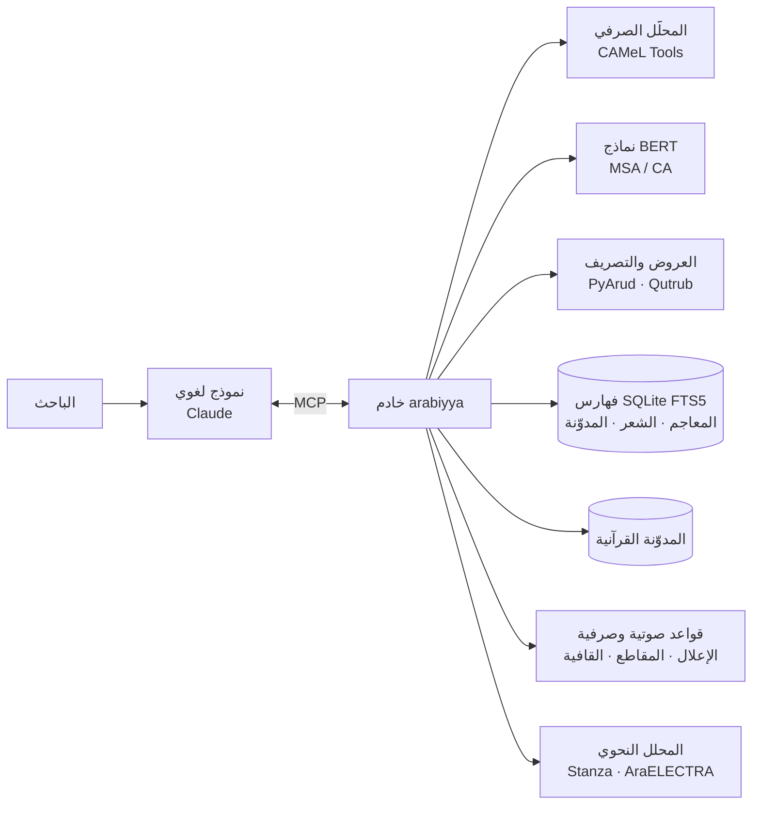

<p align="center">
  
</p>

<div dir="rtl">

# العربية (arabiyya-mcp)

**بيئة حاسوبية لعلوم العربية تتصل بالنماذج اللغوية عبر بروتوكول MCP**

[English summary](#english-summary)

## الملخّص

يجمع هذا المشروع في خادم واحد، يعمل وفق بروتوكول سياق النموذج (Model Context Protocol)، أدواتٍ حاسوبية تغطي أبرز فروع الدرس اللغوي العربي، وهي:

- الصرف والتصريف، والميزان الصرفي مع خطوات الإعلال والإبدال.
- النحو والإعراب.
- الضبط والعروض وعلم القافية.
- الأصوات.
- البلاغة (البديع).
- المعجم التراثي وكتب اللغة المتخصصة.
- الصرف القرآني.
- الشواهد الشعرية وتخريجها.
- الدلالة التوزيعية والتطور الدلالي.
- لسانيات المدوّنة والأسلوبية الإحصائية ونسبة النصوص.

**الغرض:** أن يستند النموذج اللغوي في جوابه إلى مصادر ومحلّلات يمكن التحقق منها، لا إلى ما يستظهره. فكل نتيجة تُعزى إلى مصدرها بالجزء والصفحة، أو إلى الأداة التي أنتجتها. ويصحب كل أداة بيانُ حدودها المنهجية.

**طريقة العمل:** يعمل الخادم على جهاز الباحث. تُنزَّل البيانات مرة واحدة، ثم تعمل الأدوات بلا اتصال بالشبكة، عدا أداة `lexicon_lookup` وأداة `corpus_add_book` عند تنزيل كتاب جديد.

## المحتويات

1. [البنية](#البنية)
2. [الموارد اللغوية](#الموارد-اللغوية)
3. [الأدوات ومناهجها](#الأدوات-ومناهجها)
4. [حدود المنهج](#حدود-المنهج)
5. [قياس الدقة](#قياس-الدقة)
6. [التثبيت](#التثبيت)
7. [قابلية إعادة الإنتاج](#قابلية-إعادة-الإنتاج)
8. [المراجع](#المراجع)

## البنية



البيانات كلها في قواعد SQLite محلية، وفيها فهرسة نصية كاملة (FTS5) على نصوص موحّدة الرسم:

- تُحذف الحركات.
- تُردّ الهمزات (أ إ آ ٱ) إلى الألف.
- تُكتب التاء المربوطة هاءً، والألف المقصورة ياءً.

## الموارد اللغوية

| المورد | المحتوى | الاستعمال |
|---|---|---|
| CALIMA-Star (calima-msa-r13) | قاعدة صرفية للفصحى المعاصرة فيها السوابق والجذوع واللواحق وسماتها | التحليل والتوليد الصرفي |
| CAMeLBERT-MSA (BERT unfactored) | نموذج إزالة الالتباس الصرفي بالسياق | الترجيح السياقي والتشكيل |
| CAMeLBERT-CA | نموذج BERT مدرَّب على العربية الكلاسيكية | الدلالة التوزيعية |
| المدوّنة القرآنية (Quranic Arabic Corpus) | تحليل صرفي ونحوي لكلمات القرآن مقسّمة إلى أجزاء | الصرف القرآني ومواضع الجذور |
| مدوّنة «أشعار» (Ashaar) | 254,630 قصيدة و3,863,406 أبيات، بالشاعر والبحر والعصر والغرض | الشواهد والتحليل الأسلوبي |
| OpenITI: المعاجم | 15 معجمًا من العين (ت 170هـ) إلى تاج العروس (ت 1205هـ) | مادة الجذر بالجزء والصفحة |
| OpenITI: المدوّنة | 57 مصنَّفًا في النحو واللغة والبلاغة والشعر والأدب، من القرن الثاني إلى الحادي عشر، نحو 11.9 مليون كلمة | لسانيات المدوّنة |
| فهرس OpenITI | 8,792 نسخة أصلية (primary version) من نصوص عربية، بعناوينها ومؤلفيها | توسيع المدوّنة |
| OpenITI: كتب اللغة المتخصصة | الفروق اللغوية للعسكري، والأضداد لابن الأنباري، والقلب والإبدال لابن السكيت، والإبدال والإتباع لأبي الطيب، والتعريب لابن بري، والمهذب للسيوطي، والمثلثات للمهلبي | الفروق والأضداد والإبدال والمعرّب |
| Stanza + AraELECTRA | محلل نحوي (تبعية) مدرَّب على شجرة PADT في Universal Dependencies (Qi et al., 2020؛ Antoun et al., 2021) | الإعراب |

**المعاجم الخمسة عشر:** العين، وجمهرة اللغة، وتهذيب اللغة، والصحاح، ومقاييس اللغة، ومجمل اللغة، والمحكم، والمفردات، وأساس البلاغة، والنهاية، ومختار الصحاح، ولسان العرب، والمصباح المنير، والقاموس المحيط، وتاج العروس.

**تقطيع المعاجم إلى مواد:** يجري بحسب طريقة كل معجم في الترتيب:

- **معاجم التقاليب** (العين والجمهرة والتهذيب والمحكم): تُفهرس المادة بمفتاح لا يتغير بترتيب الحروف، فتُستخرج من باب تقاليبها.
- **لسان العرب:** بعناوين مواده.
- **القاموس المحيط:** في حدود الباب والفصل.

ويُردّ كل موضع إلى الجزء والصفحة بحسب علامات الصفحات في نصوص OpenITI.

## الأدوات ومناهجها

### ١. الصرف

| الأداة | المنهج |
|---|---|
| `analyze_word` | التحليلات الممكنة كلها للكلمة المفردة من قاعدة CALIMA-Star، بلا ترجيح: الجذر والوزن والمدخل والجذع وقسم الكلم والسمات الصرفية |
| `analyze_text` | تحليل الجملة مع اختيار التحليل الأرجح بالسياق عبر مُزيل الالتباس المبني على BERT (Inoue et al., 2022) |
| `root_family` | المداخل المعجمية كلها في القاعدة الراجعة إلى جذر واحد، بأوزانها وأقسامها ومعانيها |
| `conjugate` | تصريف الفعل في الماضي والمضارع بأحواله الثلاثة والمؤكد والأمر، معلومًا ومجهولًا، عبر قطرب (Zerrouki). وتُستخرج حركة عين المضارع من صيغة المضارع في القاعدة الصرفية، ويُختار الفعل غير المشكول من مرشحات المعجم الصرفي بحسب مطابقة الرسم |

**حساب الوزن الصرفي:** صيغة CALIMA تشمل السوابق واللواحق، وتُبقي حرف العلة المنقلب ظاهرًا كما هو. فيُجرَّد الوزن أولًا من:

- أدوات الجر والعطف والتعريف.
- الضمائر المتصلة.
- علامة الإعراب.

ثم يُردّ المعتل والمضعّف إلى الميزان الصرفي المعروف:

| الكلمة | وزنها في القاعدة | الوزن بعد الردّ |
|---|---|---|
| قال | فال | فَعَل |
| يقول | يَفُول | يَفْعُل |
| بيت | فَيْل | فَعْل |
| رمى | فَعَى | فَعَل |
| اختار | افتال | افْتَعَل |
| قائل | فائل | فاعِل |
| مُدّة | فُعَّة | فُعْلَة |

**`mizan`: الميزان الصرفي وخطوات الإعلال.** محرّك قواعد (`sarf_ilal.py`) يعمل في الاتجاهين:

1. يُردّ رمز الحرف المعتل أو الهمزة في جذر CALIMA (`#`) إلى الواو أو الياء أو الهمزة. ويُرجَّح بينها بورود الجذر في المعاجم، ثم بورود الكلمة نفسها في مادته من اللسان والتاج والصحاح والقاموس والمقاييس.
2. تُجرَّب نحو مئة قالب قياسي للثلاثي ومزيده: الأفعال بأبوابها العشرة، والمصادر، والمشتقات، وجموع التكسير الشائعة. ويُبنى من كل قالب «الأصل» بوضع حروف الجذر فيه.
3. تُطبَّق قواعد الإعلال والإبدال والإدغام بترتيبها عند الصرفيين، وتُسجَّل كل خطوة بعبارتها:
   - نقل الحركة.
   - قلب حرف العلة ألفًا، وقلب الواو ياءً والياء واوًا.
   - الهمز بعد ألف فاعل، والهمز في التطرف.
   - حذف واو مفعول، على مذهب سيبويه ومع ذكر قول الأخفش.
   - اجتماع الواو والياء.
   - إبدال تاء الافتعال، وقلب فاء المثال تاءً.
   - حذف فاء المثال في المضارع.
   - إعلال المنقوص المنوّن.
   - إدغام المثلين، ومصدر الأجوف من أفعل واستفعل.
4. **التحقق الذاتي:** لا يُقبل القالب إلا إذا أعادت القواعدُ الأصلَ إلى الكلمة نفسها حرفًا وشدّةً وحركة.

ويُعرض بعد ذلك: الوزن الأصلي، والوزن على لفظ الكلمة (قائل: فائل، اتّصل: اِتَّعَل، يعد: يَعِل)، ونوع الجذر، ونوع الإعلال في كل خطوة.

| الكلمة | الأصل | الخطوات |
|---|---|---|
| مَقُول | مَقْوُول | نقل الحركة إلى القاف، ثم حذف واو مفعول لالتقاء الساكنين |
| مَبِيع | مَبْيُوع | نقل الحركة، ثم حذف واو مفعول، ثم كسر الباء لتصح الياء |
| مِيزان | مِوْزان | سكنت الواو بعد كسرة فقُلبت ياءً |
| اِتَّصَلَ | اِوْتَصَلَ | قُلبت فاء الافتعال تاءً وأُدغمت |
| مَرْمِيّ | مَرْمُوي | اجتمعت الواو والياء وسبقت إحداهما بالسكون فقُلبت ياءً وأُدغمت، وكُسر ما قبلها |
| اِسْتِقامَة | اِسْتِقْوام | نقل وقلب، ثم حذف إحدى الألفين والتعويض بالتاء |
| داعٍ | داعِوٌ | قُلبت الواو ياءً لتطرفها بعد كسرة، ثم حُذفت لالتقاء الساكنين |

وفي `tests/test_ilal.py` ثلاث وأربعون حالة معيارية من كتب الصرف تجتازها القواعد كلها.

**`mushtaqqat`:** يولّد المشتقات القياسية من الفعل بقوالبها، ثم بقواعد الإعلال نفسها:

- اسم الفاعل، واسم المفعول، والمصدر الميمي، واسما الزمان والمكان (مَفْعَل أو مَفْعِل بحسب عين المضارع وكون الفعل مثالًا).
- اسم الآلة، وصيغ المبالغة، واسم التفضيل، واسما المرة والهيئة.
- مصادر المزيد ومشتقاته.

ويُعلَّم كل مولَّد بأنه مستعمل في المعجم الصرفي أو قياسي لم يُسمع فيه.

**`taqalib`:** التباديل الستة للجذر الثلاثي (أو الأربعة والعشرون للرباعي)، ويُحكم بالاستعمال بورود التقليب في المعاجم المرتبة على الحروف. ولا يكفي ذكره في أبواب التقاليب، لأن الخليل يذكر فيها المهمل أيضًا.

**`irab`: الإعراب.** يُحلَّل النص بمحلل التبعية Stanza، بنموذج AraELECTRA المدرَّب على شجرة PADT، فيُستخرج لكل كلمة:

- قسمها.
- سماتها: الحالة الإعرابية، والتعريف والتنكير، والإعراب والبناء في الفعل، والبناء للمعلوم والمجهول.
- عاملها.
- علاقتها به.

ثم تُنقل العلاقات إلى أبواب النحو بقواعد:

| علاقة UD | الباب في النحو العربي |
|---|---|
| `nsubj` مع فعل | فاعل |
| `nsubj` مع فعل ناسخ | اسم كان أو اسم إنّ |
| `nsubj` في جملة اسمية | مبتدأ، وخبره رأس الجملة |
| `nsubj:pass` | نائب فاعل |
| `obj` | مفعول به |
| `amod` | نعت |
| `conj` | معطوف |
| `appos` | بدل |
| `nmod` في حالة الجر | مضاف إليه |
| مع حرف جر | اسم مجرور |
| `obl` منصوب | ظرف، أو مفعول مطلق إذا اتحد جذره بجذر الفعل، أو حال، أو مفعول لأجله أو تمييز بحسب المعنى |

وتُستخرج علامة الإعراب الأصلية أو الفرعية من صورة الكلمة:

- المثنى، وجمع المذكر السالم.
- جمع المؤنث السالم في النصب.
- الأسماء الخمسة.
- الأفعال الخمسة.
- المقصور والمنقوص، والمعتل الآخر في الجزم.

ثم يُقترح ضبط أواخر الكلمات بحسب مواقعها، وبهذا تُصحَّح علامات الإعراب في التشكيل الآلي.

### ٢. الضبط والعروض

| الأداة | المنهج |
|---|---|
| `diacritize` | التشكيل بالتحليل الأرجح سياقيًّا لكل كلمة |
| `scan_verse` | التقطيع العروضي عبر PyArud: البحر، والتفعيلات، والزحافات والعلل، والقافية والروي |
| `scan_poem` | تقطيع القصيدة بيتًا بيتًا، وتحديد البحر والروي الغالبين، والتنبيه على كل بيت خالفهما أو اختل وزنه |

**أثر التشكيل في التقطيع:** التقطيع العروضي يتوقف على التشكيل التام، والتشكيل الناقص يُفسده. فيُقاس أولًا ما في البيت من تشكيل، أي نسبة الحركات إلى الحروف:

| نسبة التشكيل | المعالجة |
|---|---|
| أقل من 0.3 | يُشكَّل البيت آليًّا كله |
| من 0.3 إلى أقل من 0.85 | يُملأ الناقص من التشكيل الآلي، مع إبقاء ضبط الأصل حيث وُجد، كلمةً كلمة إذا تطابق رسم الكلمة في النصّين |
| 0.85 فأكثر | يُقطَّع البيت كما هو |

**التشكيل الموجَّه بالعروض.** إذا لم يستقم البيت بعد التشكيل، تُجمع لكل كلمة ضبوطها الممكنة:

- تحليلات المحلل الصرفي.
- بدائل حركة الآخر: الحركات الثلاث، والتنوين، والسكون.
- إشباع هاء الكناية، وصلة ميم الجمع.

وكلها مقيّدة بما ضبطه صاحب النص.

ثم يُبحث بالعمق مع التقليم عن أقل عدد من التغييرات يجعل نمط الشطر من الأنماط الصحيحة لبحره. وأنماط البحور مأخوذة من نحو البحور في PyArud بزحافاتها وعللها، وتُقلَّم كل بادئة لا تفضي إلى نمط صحيح.

ويُعرض كل تغيير للباحث، وهو «ضبط يقتضيه الوزن، لا رواية محققة».

وفي هذه المرحلة أُصلحت علّتان:

- **شدة الحرف الشمسي:** يغفلها ضبط CAMeL بعد «ال»، فيسقط بسقوطها مقطع، فصارت تُثبَت.
- **قاعدة «يس ← ياسين» في PyArud:** كانت تُطبَّق على آخر «ليس» و«وليس» فتفسد وزنهما.

**`analyze_qafiya`: علم القافية.** تُحدَّد عناصر القافية لكل بيت بقواعد العروضيين:

- الروي، بعد استبعاد ألف الإطلاق وواوه ويائه، وهاء الوصل إذا تحرك ما قبلها.
- الوصل والخروج.
- الردف.
- التأسيس، بشرط كونه في كلمة الروي، والدخيل.
- الحركات: المجرى، والنفاذ، والحذو، والإشباع، والرس، والتوجيه.

ويُرجَّح الروي على مستوى القصيدة كلها، إذا احتمل البيت الواحد أكثر من روي.

ثم تُرصد العيوب:

- **الإقواء والإصراف:** اختلاف المجرى.
- **الإكفاء والإجازة:** اختلاف الروي بحرف متقارب المخرج أو متباعده.
- **سناد الردف:** ومن صوره تعاقب الألف مع الواو أو الياء، أما تعاقب الواو والياء فجائز.
- **سناد التأسيس، وسناد الإشباع، وسناد الحذو، وسناد التوجيه.**
- **الإيطاء:** تكرار كلمة القافية، مع حساب المسافة بين التكرارين وحدّ السبعة الأبيات.

### ٢ب. البلاغة

**`detect_badi`:** يرصد مرشحات المحسنات البديعية:

| النوع | طريقة الرصد |
|---|---|
| الجناس التام | تطابق الحروف واختلاف المدخل المعجمي |
| الجناس المحرّف | اختلاف الحركات وحدها |
| الجناس المضارع واللاحق | اختلاف حرف واحد متقارب المخرج أو متباعده (بجدول المخارج في `huruf`) |
| الجناس الناقص | زيادة حرف |
| جناس الاشتقاق | اتحاد الجذر |
| طباق الإيجاب | بمعجم أضداد مختار |
| طباق السلب | الإثبات والنفي للمدخل نفسه |
| المقابلة | زوجان متضادان فأكثر |
| التصريع | اتفاق روي الصدر والعجز |
| ردّ العجز على الصدر | تكرار كلمة القافية أو جذرها في الصدر |
| لزوم ما لا يلزم | التزام حرف قبل الروي في القصيدة |
| السجع المطرَّف والمتوازي | اتفاق الفاصلتين رويًّا، واتفاقهما وزنًا في المتوازي |
| الاقتباس | اتفاق أربع كلمات متتالية فأكثر مع النص القرآني |

### ٣. الأصوات

**`phonetics`: تحويل الحروف إلى أصوات بالقواعد.** يحوّل النص المشكول إلى كتابة صوتية وظيفية (phonemic) بالأبجدية الصوتية الدولية (IPA)، مع مراعاة:

- همزة الوصل: تُنطق في الابتداء وتسقط في الدرج.
- اللام الشمسية والقمرية.
- التنوين.
- التقاء الساكنين: يُقصَّر المدّ ويُحرَّك الساكن.
- الوقف: بالسكون، وعلى تنوين النصب ألفًا، وعلى التاء المربوطة هاءً.
- الألف الفارقة.
- الألف المحذوفة رسمًا: هذا، ذلك، لكن، الله، إله، الرحمن، السماوات.

**التقطيع إلى مقاطع:** يبدأ كل مقطع بصامت واحد، وأنواع المقاطع خمسة:

| النوع | الوصف |
|---|---|
| CV | قصير |
| CVV | طويل مفتوح |
| CVC | طويل مغلق |
| CVVC | مديد |
| CVCC | مديد |

وتُقابَل المقاطع برموزها العروضية: `/` للمتحرك و`0` للساكن.

**النبر:** يُعطى تقريبيًّا بقاعدة الفصحى المعاصرة (Ryding, 2005):

- يقع على المقطع الأخير إن كان مديدًا.
- وإلا فعلى ما قبل الأخير إن كان طويلًا.
- وإلا فعلى الثالث من الآخر.

**`huruf`: المخارج والصفات.**

- **المخارج:** السبعة عشر على مذهب ابن الجزري في المقدمة الجزرية.
- **الصفات التي لها ضد:** الجهر والهمس، والشدة والتوسط والرخاوة، والاستعلاء والاستفال، والإطباق والانفتاح، والإذلاق والإصمات.
- **الصفات التي لا ضد لها:** الصفير، والقلقلة، والانحراف، والتكرير، والتفشي، والاستطالة، والغنة، واللين.
- **الوصف الصوتي الحديث:** موضع النطق، وطريقته، والرمز الدولي.
- **الموازنة بين حرفين:** تُصنَّف العلاقة بينهما بمصطلح أهل الأداء:
  - متجانسان: اتحدا مخرجًا.
  - متقاربان مخرجًا: تجاور مخرجاهما.
  - متقاربان صفةً.
  - متباعدان.
- **الخلاف بين الوصفين القديم والحديث:** يُنبَّه عليه، كجهر الطاء والقاف عند سيبويه، وجانبية الضاد القديمة.

### ٤. المعجم والقرآن والشعر

| الأداة | المنهج |
|---|---|
| `maajim` | مادة الجذر من المعاجم الخمسة عشر، مرتبةً بوفيات مؤلفيها، بالجزء والصفحة. وفي معاجم التقاليب يبدأ النص من موضع المادة داخل بابها |
| `lexicon_lookup` | البحث في نحو 47 معجمًا عربيًّا وعربيًّا إنجليزيًّا في موقع The Arabic Lexicon (يلزمه اتصال) |
| `quran_word` | أجزاء كل كلمة في الآية: النوع، والجذر، والصيغة، والسمات، والإعراب (Dukes & Habash, 2010) |
| `quran_root` | مواضع الجذر في القرآن، وصيغه وعدد كلٍّ منها |
| `search_poetry` | البحث النصي في مدوّنة «أشعار» بتوحيد الرسم، مع التقييد بالشاعر أو البحر أو العصر |
| `takhrij_shahid` | تخريج البيت: يُبحث عنه بفهرس «أشعار» ثم يُرتَّب بالتطابق اللفظي (SequenceMatcher على الكلمات الموحّدة الرسم)، فتُذكر نسبته، واختلاف روايته كلمةً كلمة، واختلاف نسبته، ويُفصل ذلك عن المعارضات والتضمين. ثم تُطلب مواضعه في كتب المدوّنة بثلاثيات الكلمات، ويُتحقق من كل موضع بنسبة ما يغطيه من ألفاظ البيت، ويُستخرج قول المؤلف «والشاهد فيه...» إن وُجد |
| `lughawiyyat` | البحث في كتب الفروق والأضداد والإبدال والإتباع والمعرّب والمثلثات وفقه اللغة، بالجزء والصفحة |

### ٥. الدلالة التوزيعية

تعتمد على نموذج CAMeLBERT-CA (Inoue et al., 2021). وتمثيل الكلمة هو متوسط الطبقات الأربع الأخيرة من النموذج، على الأجزاء التي يقطّعها إليها، مُطبَّعًا (normalized).

| الأداة | المنهج |
|---|---|
| `word_similarity` | جيب التمام بين تمثيلَي الكلمتين، إما منفردتين وإما في سياقَي جملتين، وبالثاني يُميَّز بين معاني المشترك اللفظي |
| `substitutes_in_context` | تُحجب الكلمة في جملتها ويُطلب من النموذج ما يصلح مكانها (masked language modeling) |
| `semantic_neighbors` | أقرب المفردات إلى الكلمة في معجم النموذج (نحو 21,500 مفردة) |

**`semantic_change`: التطور الدلالي.** تُقسم المدوّنة إلى حقب بالقرون الهجرية، ويُحسب لكل حقبة:

- تكرار اللفظ لكل مليون كلمة.
- متلازماته بنسبة الأرجحية.
- تداخل متلازمات الحقب المتتالية بمعامل جاكار، وما استجدّ منها وما غاب.
- الابتعاد السياقي: متوسط تمثيل اللفظ في سياقاته من كل حقبة بنموذج CAMeLBERT-CA، والبعد بين المتوسطات، على طريقة Giulianelli et al. (2020) مبسّطةً.

مثاله «الاستعارة»:

| الحقبة | أقوى المتلازمات |
|---|---|
| القرن 2–4 | «أبلغ»، و«حقيقته» |
| القرن 5–7 | «الكناية»، و«التمثيل»، و«التشبيه» |
| القرن 8–11 | «التخييلية»، و«التحقيقية»، و«التبعية» |

وفي هذا أثر استقرار المصطلح البلاغي وتفريعه.

**معالجة تقارب الاتجاهات في `semantic_neighbors`:** تمثيلات نماذج BERT خارج السياق تتجه كلها إلى جهة واحدة تقريبًا (anisotropy)، فيتقارب جيب التمام بين أي كلمتين. ويُخفَّف ذلك بطرح متوسط المتجهات (mean-centering) على نحو ما في Mu & Viswanath (2018).

### ٦. لسانيات المدوّنة

| الأداة | المنهج |
|---|---|
| `corpus_concordance` | السياقات بطريقة KWIC، مقيّدةً بالفن أو القرن أو الكتاب، مع إمكان شمول السوابق (و، ف، ب، ك، ل، وال...) |
| `corpus_usage` | ورود اللفظ في كل قرن هجري بحسب وفاة المؤلف، مُطبَّعًا لكل مليون كلمة من نصوص ذلك القرن، مع توزّعه على الفنون والكتب |
| `corpus_collocates` | المتلازمات في نافذة ±k: نسبة الأرجحية (Log-likelihood) على جدول توافق 2×2 (Dunning, 1993)، مع المعلومات المتبادلة النقطية PMI (Church & Hanks, 1990)، بعد حذف حروف المعاني |
| `corpus_find_book` | البحث في فهرس OpenITI العربي بالعنوان أو المؤلف |
| `corpus_add_book` / `corpus_remove_book` | تنزيل نص من OpenITI وتقطيعه إلى فقرات وفهرسته وتحديث جدول التكرار، أو حذفه وحذف أثره من الفهرس والتكرار |
| `usage_compare` | موازنة تعبيرين أو أكثر (مسائل التعدية والاستعمال): الورود، والنسبة لكل مليون كلمة، والتوزع على الفنون والقرون، والشواهد |

### ٧. الأسلوبية الإحصائية

**`text_profile`:** يصف نصًّا أو ديوانًا بـ:

- عدد الكلمات وأنواعها، والكلمات المفردة الورود (hapax legomena).
- أكثر الجذور والمداخل والأوزان ورودًا.
- توزّع أقسام الكلم.

**`compare_texts`:** يوازن بين جانبين. وكل جانب نصٌّ معطى، أو ديوان شاعر، أو كتاب من المدوّنة. ويُخرج:

- **الإبانة (keyness):** ما يختص به كل جانب من الألفاظ والجذور والأوزان. يُقاس بنسبة الأرجحية (Rayson & Garside, 2000) بعتبة 10.83 (p < 0.001)، مع نسبة اللوغاريتم Log Ratio لقياس حجم الفرق (Hardie, 2014)، وفيها تمهيد بـ 0.5 للأصفار.
- **ثراء المعجم:** نسبة الأنواع إلى الكلمات المعيارية (STTR)، وهي متوسط النسبة في كل ألف كلمة، فلا تتأثر بتفاوت طول النصّين.
- **التداخل المعجمي:** معامل جاكار (Jaccard) للألفاظ وللجذور.
- **المعجم المشترك:** مرتبًا بأدنى التكرارين النسبيين.

**`attribute_author`: نسبة النص إلى قائله.** تُحسب نسب أكثر الألفاظ دورانًا، وجلّها حروف المعاني والضمائر. ثم تُحوَّل إلى درجات معيارية بمتوسط مقاطع نصوص المرشحين وانحرافها، ويُقاس البعد بين النص وكل مرشح بمقياسين:

- **Delta:** مقياس Burrows (2002).
- **Cosine Delta:** مقياس Smith & Aldridge (2011).

والنتيجة قرينة إحصائية تُضمّ إلى أدلة النسبة الأخرى.

## حدود المنهج

1. **أصل القاعدة الصرفية:** CALIMA-Star مبنية للفصحى المعاصرة، فقد يغيب عنها بعض الغريب التراثي، أو يُرجَّح فيه معنى معاصر.
2. **التشكيل الآلي:** مدرَّب على نصوص معاصرة، فيقلّ ضبطه في الشعر الجاهلي والعباسي. والأولى إدخال الشعر مشكولًا لصحة التقطيع والتحليل الصوتي.
3. **التحليل في الإحصاءات الأسلوبية:** الجذور والأوزان فيها هي أرجح تحليل لكل نوع (type) منفردًا بلا سياق، فالأرقام تقديرية تصلح للمقارنة النسبية دون العدّ القاطع.
4. **نصوص OpenITI:** أكثرها غير مشكول ولم يُراجَع يدويًّا، وبعض نسخها ناقص. والجزء والصفحة بحسب الطبعة التي في المكتبة الشاملة.
5. **تمثيل المدوّنة:** المدوّنة مختارة لا شاملة، وأحجام القرون فيها متفاوتة. فالتطبيع لكل مليون كلمة أدقّ من العدد المجرد، ولا يُعمَّم الحكم على العربية كلها.
6. **عدّ الألفاظ:** يُعدّ اللفظ في المدوّنة بصورته بعد توحيد الرسم، دون تجريد سوابقه.
7. **الكتابة الصوتية:** وظيفية لا نطقية، فلا تُظهر التفخيم في الحركات ولا الإخفاء والإقلاب ونحوهما من أحكام التجويد. والنبر لم يصفه القدماء، فهو تقريب بقاعدة معاصرة.
8. **الإعراب:** المحلل النحوي مدرَّب على لغة الصحافة المعاصرة (PADT)، فتقلّ دقته في الشعر والتقديم والتأخير. وتمييز الحال من التمييز ومن المفعول لأجله يتوقف على المعنى، فيُذكر بوجوهه.
9. **البديع:** ما يقوم على المعنى الخفي، كالتورية والاستخدام، لا يُرصد. والطباق محصور في معجم الأضداد المختار.
10. **نسبة النصوص:** تضعف إذا قصر النص عن ألف كلمة، أو اختلف عصر المرشحين أو فنّهم.

## قياس الدقة

أداة `benchmark` تقيس الدقة على بيانات معيارية محلية، ويُعاد إنتاج كل رقم ببذرة العينة:

| المهمة | البيانات | المقياس | النتيجة |
|---|---|---|---|
| استخراج الجذر | 2,000 كلمة عشوائية من القرآن (المدوّنة القرآنية) | الجذر بأرجح تحليل بلا سياق | 78.8% (والصحيح بين التحليلات الممكنة 81.7%) |
| نسبة النص إلى قائله | 30 شاعرًا من «أشعار»، ونص مختبر من نحو 1500 كلمة معزول عن شعر صاحبه بعد حذف المكرر | Cosine Delta على 150 لفظًا | 96.7% (خط الأساس 3.3%) |
| الميزان والإعلال | 43 حالة معيارية من كتب الصرف (`tests/test_ilal.py`) | مطابقة الأصل والصورة | 43/43 |
| التشكيل (CATT) | 40 سطرًا نثريًا من اختبار Tashkeela (Fadel et al., 2019) | DER / WER | 1.1% / 2.9% |
| التشكيل (CATT) | 40 بيتًا مشكولًا من «أشعار» | DER / WER | 15.2% / 33.9% (فيُكمَّل في الشعر بالضبط الموجَّه بالعروض) |
| التقطيع بالضبط الموجَّه | 210 أبيات من 14 بحرًا، منزوعة التشكيل ومشكولة بأرجح تحليل بلا سياق | الأبيات الموزونة | من 1.9% إلى 31.4% (مع المشكِّل السياقي تُقاس بـ `benchmark("meter")`) |

التشكيل بمحرك CATT (Abjad AI، رخصة Apache-2.0)، ويُرجَع إلى مشكِّل CAMeL عند تعذّره. ولتحسين تشكيل الشعر نموذج اختياري (BiLSTM على مستوى الحرف) يُدرَّب محليًا على Tashkeela وأبيات «أشعار» المشكولة بـ `train_diacritizer.py` (أو `train_diacritizer.bat` على ويندوز)، ولا يُستعمل إلا إذا كان خطؤه على أبيات الاختبار أقل من CATT، ويُكتب تقريره في `~/.sarf/models/diac_ca/report.txt`.

تنبيه: نسبة النصوص قيست على شعراء أكثرهم معاصرون متمايزو المعجم، فلا تُعمَّم على الشعر القديم. وفي «أشعار» قصائد مكررة وأبيات مختلّة، فأرقام التقطيع حدٌّ أدنى.

## التثبيت

**المتطلبات:**

- تطبيق [Claude Desktop](https://claude.ai/download) أو أي عميل يدعم MCP.
- ويندوز 10/11 أو macOS.
- نحو 3 غيغابايت من المساحة.
- اتصال بالشبكة عند التثبيت لتنزيل البيانات.

| النظام | الخطوات |
|---|---|
| ويندوز | نزّل المستودع (Code ← Download ZIP)، ثم شغّل `install_sarf_windows.bat`، ثم أعد تشغيل Claude |
| macOS | ضع المستودع في مجلد دائم، ثم شغّل `install_sarf.command`، ثم أعد تشغيل Claude |

**ما يفعله سكربت التثبيت:**

1. يثبّت Miniconda إن لم يكن موجودًا (وعلى ويندوز Node.js أيضًا).
2. ينشئ بيئة Python 3.11.
3. يثبّت المكتبات.
4. ينزّل بيانات CAMeL والنماذج.
5. يبني الفهارس في مجلد `~/.sarf`.
6. يضيف الخادم إلى إعدادات Claude باسم `arabiyya`.

وإعادة تشغيله آمنة: يتخطى ما سبق تجهيزه، ولا يمسّ الكتب المضافة إلى المدوّنة.

**التشغيل اليدوي في أي عميل MCP:**

```json
{
  "mcpServers": {
    "arabiyya": { "command": "<python-of-env>", "args": ["<path>/sarf_mcp.py"] }
  }
}
```

ويعمل الخادم بنقل HTTP المتدفّق (streamable HTTP) إذا عُيِّن متغير البيئة `SARF_SECRET`.

## قابلية إعادة الإنتاج

| الملف | عمله |
|---|---|
| `sarf_mcp.py` | الخادم والأدوات |
| `setup_sarf_data.py` | تجهيز البيانات بخطوات مستقلة يتخطى كلٌّ منها ما سبق إنجازه |
| `build_lexicon_index.py` | بناء فهرس المعاجم وقواعد تقطيع كل معجم |
| `build_poetry_index.py` | بناء فهرس «أشعار» |
| `build_corpus_index.py` | قائمة كتب المدوّنة بفنونها ومعرّفاتها في OpenITI، وبناء فهرسها |
| `sarf_ilal.py` | محرّك الميزان الصرفي وقواعد الإعلال والإبدال والإدغام وقوالب الصيغ |
| `tests/test_ilal.py` | الحالات المعيارية لمحرّك الإعلال |
| `openiti_catalog.tsv` | فهرس النسخ الأصلية العربية في OpenITI، مستخرج من بيانات `kitab-metadata-automation` |

## المراجع

<div dir="ltr">

- Alyafeai, Z., Al-Shaibani, M. S., & Ahmed, M. (2023). Ashaar: Automatic analysis and generation of Arabic poetry using deep learning approaches. *arXiv:2307.06218*.
- Church, K. W., & Hanks, P. (1990). Word association norms, mutual information, and lexicography. *Computational Linguistics*, 16(1), 22–29.
- Dukes, K., & Habash, N. (2010). Morphological annotation of Quranic Arabic. *Proceedings of LREC 2010*.
- Dunning, T. (1993). Accurate methods for the statistics of surprise and coincidence. *Computational Linguistics*, 19(1), 61–74.
- Antoun, W., Baly, F., & Hajj, H. (2021). AraELECTRA: Pre-training text discriminators for Arabic language understanding. *Proceedings of WANLP 2021*.
- Burrows, J. (2002). 'Delta': A measure of stylistic difference and a guide to likely authorship. *Literary and Linguistic Computing*, 17(3), 267–287.
- Giulianelli, M., Del Tredici, M., & Fernández, R. (2020). Analysing lexical semantic change with contextualised word representations. *Proceedings of ACL 2020*.
- Hardie, A. (2014). Log Ratio – an informal introduction. ESRC Centre for Corpus Approaches to Social Science (CASS).
- Inoue, G., Alhafni, B., Baimukan, N., Bouamor, H., & Habash, N. (2021). The interplay of variant, size, and task type in Arabic pre-trained language models. *Proceedings of WANLP 2021*.
- Inoue, G., Khalifa, S., & Habash, N. (2022). Morphosyntactic tagging with pre-trained language models for Arabic and its dialects. *Findings of ACL 2022*.
- Mu, J., & Viswanath, P. (2018). All-but-the-top: Simple and effective postprocessing for word representations. *ICLR 2018*.
- Nigst, L., Romanov, M., Savant, S. B., Seydi, M., & Verkinderen, P. *OpenITI: A Machine-Readable Corpus of Islamicate Texts*. Zenodo.
- Obeid, O., Zalmout, N., Khalifa, S., Taji, D., Oudah, M., Alhafni, B., Inoue, G., Eryani, F., Erdmann, A., & Habash, N. (2020). CAMeL Tools: An open source Python toolkit for Arabic natural language processing. *Proceedings of LREC 2020*.
- Qi, P., Zhang, Y., Zhang, Y., Bolton, J., & Manning, C. D. (2020). Stanza: A Python natural language processing toolkit for many human languages. *Proceedings of ACL 2020: System Demonstrations*.
- Rayson, P., & Garside, R. (2000). Comparing corpora using frequency profiling. *Proceedings of the Workshop on Comparing Corpora, ACL 2000*.
- Ryding, K. C. (2005). *A Reference Grammar of Modern Standard Arabic*. Cambridge University Press.
- Smith, P. W. H., & Aldridge, W. (2011). Improving authorship attribution: Optimizing Burrows' Delta method. *Journal of Quantitative Linguistics*, 18(1), 63–88.
- Taji, D., Khalifa, S., Obeid, O., Eryani, F., & Habash, N. (2018). An Arabic morphological analyzer and generator with copious features. *Proceedings of SIGMORPHON 2018*.
- Zerrouki, T. *Qutrub: Arabic verb conjugator*. https://github.com/linuxscout/qutrub
- *PyArud*: Arabic prosody analyzer. https://pypi.org/project/pyarud/

</div>

**ومن المصادر التراثية:**

- سيبويه، *الكتاب*، باب الإدغام (في مخارج الحروف وصفاتها).
- ابن جني، *سر صناعة الإعراب*.
- سيبويه، *الكتاب*، أبواب الإعلال والإبدال؛ وابن جني، *المنصف شرح التصريف*؛ ورضي الدين الأستراباذي، *شرح الشافية* (في الإعلال والإدغام).
- الأخفش، *القوافي*؛ والتبريزي، *الكافي في العروض والقوافي* (في عناصر القافية وعيوبها).
- الخليل، *العين* (في التقاليب)؛ وابن جني، *الخصائص*، باب الاشتقاق الأكبر.
- ابن الجزري، *المقدمة الجزرية*، و*النشر في القراءات العشر*.

## طريقة الاستشهاد

<div dir="ltr">

```bibtex
@software{arabiyya_mcp_2026,
  author  = {Sayed Hassan},
  title   = {arabiyya: A Model Context Protocol server for Arabic linguistic research},
  year    = {2026},
  version = {1.0.0},
  url     = {https://github.com/Sayedforces2021/arabiyya-mcp},
  license = {MIT}
}
```

</div>

ويُستشهد كذلك بالموارد التي اعتمدت عليها الأداة المستعملة (انظر [المراجع](#المراجع)).

## الرخص

- **الشيفرة:** مرخّصة برخصة MIT (انظر `LICENSE`).
- **البيانات:** لا تتضمن الشيفرة شيئًا من البيانات، وإنما تنزّلها من مصادرها عند التثبيت.
- **النماذج والمدوّنات:** تخضع لشروط ناشريها، وأكثرها للاستعمال البحثي غير التجاري.

</div>

---

## English summary

**arabiyya** is a Model Context Protocol (MCP) server that exposes 37 tools for Arabic linguistic research to LLM clients such as Claude Desktop. It runs locally and, after a one-time data download, works offline.

**Morphology**
- Context-free and BERT-disambiguated analysis (CAMeL Tools, CALIMA-Star), root families, and verb conjugation (Qutrub).
- A rule-based *i'lāl/ibdāl/idghām* engine (`sarf_ilal.py`) that reconstructs the underlying form (*aṣl*) of a word and derives its surface form step by step, using the terminology of classical grammarians. Each derivation is self-verified: it is accepted only if it reproduces the input word.
- Qiyāsī derivatives, and root permutations (*taqālīb*).

**Syntax**
- *Iʿrāb* via the Stanza dependency parser (AraELECTRA, PADT). UD relations and features are mapped to traditional grammatical functions and case/mood markers, and case endings are proposed from the parse.

**Prosody and rhyme**
- Verse and poem scansion (PyArud), with **prosody-guided diacritization**: a pruned search over each word's candidate vocalizations finds the minimal change that fits the meter's grammar.
- Full *ʿilm al-qāfiya*: rhyme letter and elements, rhyme types, and rhyme defects (*iqwāʾ, ikfāʾ, sinād, īṭāʾ*).

**Phonology**
- Rule-based grapheme-to-phoneme conversion to IPA, syllabification, and approximate stress.
- Articulation points and features of letters after Ibn al-Jazarī.

**Rhetoric**
- Candidate detection of *jinās, ṭibāq, muqābala, taṣrīʿ, radd al-ʿajuz, sajʿ*, and Qurʾānic quotation (*iqtibās*).

**Lexicography**
- 15 classical dictionaries from OpenITI, segmented into entries and cited by volume and page.
- Specialized works on synonym distinctions, *aḍdād*, *ibdāl* and loanwords.

**Poetry**
- Search over 3.86M verses (Ashaar).
- Verse attribution and variant readings, and the grammar and rhetoric books that cite a verse as evidence (*takhrīj al-shāhid*).

**Corpus linguistics and semantics**
- KWIC concordances, diachronic frequency, log-likelihood/PMI collocations and expression comparison.
- Diachronic semantic change via collocate shift and contextual-embedding drift (CAMeLBERT-CA).
- The default corpus is 57 classical works (~12M tokens), extensible with any of ~8.8k OpenITI texts.

**Stylometry**
- Keyness, standardized TTR and Jaccard overlap.
- Authorship attribution with Burrows's Delta and Cosine Delta.

**Evaluation**
- A `benchmark` tool reports accuracy on local gold data: meter labels from Ashaar, roots from the Quranic Arabic Corpus, and held-out authorship attribution.
